# MICRO'26 | EdgeXpert：让 MoE 与推测解码不再互相拖累的片外访存优化

> 原文：[EdgeXpert: An Edge Device for Memory-Efficient LLM Inference with Mixture-of-Experts and Speculative Decoding](https://arxiv.org/html/2608.05303v1)
>
> 本文解读 arXiv v1，首次提交于 **2026 年 8 月 5 日**。截至本文写作日 2026 年 11 月 7 日，MICRO'26 已于 10 月 31 日至 11 月 4 日举行；论文出现在[官方主程序](https://microarch.org/micro59/program/)的 “Distinguished Papers II — Security, Verification & Efficient ML Systems” session 中。下文性能数字来自原文，不是本文复现实测。[1][2]

---

## 1. 单个 token 很稀疏，为什么一起验证就不省了？

先交代下背景。

MoE，Mixture-of-Experts，混合专家，是一类模型架构，不是某个模型的名字。它把 Transformer 中的 FFN——对每个 token 做非线性变换的前馈网络——拆成多个 expert，再让 router 根据 token 的隐藏表示挑选少数专家参与计算。Qwen3-30B-A3B、DeepSeek-V2-Lite 都属于这一类。

听起来很适合端侧：模型总参数可以很大，但每次只用一小部分。

另一边，speculative decoding，推测解码，也很适合端侧。一个轻量的 draft model 先猜出若干候选 token，target model 再一次性验证，接受其中正确的连续路径。只要每轮能多产出几个 token，大模型反复读取权重的次数就少了。

两个省钱方案放在一起，按理说应该更省吧？

EdgeXpert 给出的结果很直白：在它的 Qwen3-30B-A3B + EAGLE-3 配置中，普通逐 token 解码每层每轮激活 8 个专家；一起验证候选后，**每层每轮平均激活 52.1 个专家**。虽然一轮平均能推进 4.3 个 token，但专家激活规模增长了约 6.5 倍。未经针对性优化的组合，整体能耗反而比逐 token 解码增加 24.3%。[1，§I]

如下图，左边一次只服务一个 token，右边必须服务整批候选。关键不是某个 token 选了多少专家，而是**所有候选合起来选了多少不同的专家**。

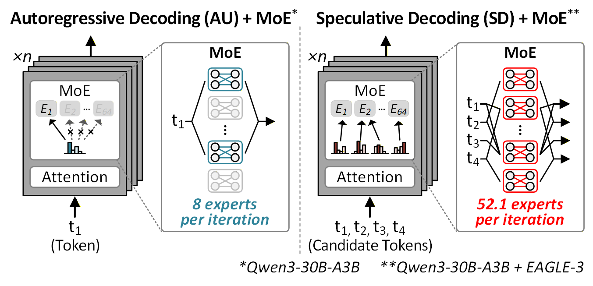

这个区别就是全文的主线：**单 token 稀疏，不等于联合执行时的访存也稀疏。**

EdgeXpert 没有停在“把更多专家剪掉”。它分别处理两个阶段：

- **prefill**：一次处理输入 prompt、建立后续生成所需的状态，让不那么重要的 token 优先复用已有专家；
- **decode**：逐步生成输出，在候选树验证中合并专家内部通道的读取需求，并用已经读进来的数据补回部分计算。

它真正盯住的不是总参数量，而是：**为了生成一个最终被接受的 token，究竟要从片外搬多少权重？**[1]

## 2. “Memory efficient” 至少有三个问题，不能混着比较

### 2.1 装得下、搬得少、算得少，不是一回事

MoE 的内存优化文献很多，但目标并不统一。

| 优化目标 | 典型问题 | 常见手段 |
|---|---|---|
| 容量 | 权重能否装进 GPU 显存或设备内存？ | 量化、专家剪枝、卸载 |
| 数据移动 | 每轮要搬多少权重，从哪个内存层级搬？ | 缓存、预取、访存感知路由、选择性加载 |
| 运算量 | 实际执行多少乘加？ | 专家跳过、通道剪枝、稀疏算子 |

这三类优化可能互相促进，但不能画等号。比如，把大部分专家卸载到 CPU 内存确实省 GPU 显存，可一旦不断 miss，CPU–GPU 搬运就会成为新的瓶颈。又比如，某个 token 的一半通道不用算了，但其他 token 仍然要用，权重未必少读。

EdgeXpert 讨论的是端侧加速器中的 **EMA，external memory access，片外内存访问**：权重从片外 DRAM 搬到芯片内部再计算。它使用的 LPDDR4X 是低功耗移动内存，实验带宽为 16 GB/s。

这和“权重已经常驻 GPU 显存，只需从显存读入计算单元”，或者“从 SSD 把专家换进设备 DRAM”，不是同一个层级的成本模型。读 related work 时，先把这件事对齐。[1，§II-A、§V-A]

### 2.2 稀疏性的收益，被并集吃掉了

设某一层共有 $E$ 个专家，每个 token 激活 $k$ 个。一次验证 $M$ 个候选，候选 $t$ 的专家集合记作 $\mathcal E_t$，实际需要服务的专家是：

$$
\mathcal E_{\mathrm{verify}}
=\bigcup_{t=1}^{M}\mathcal E_t.
$$

通常有：

$$
k\leq |\mathcal E_{\mathrm{verify}}|\leq \min(E,Mk).
$$

例如，两个 token 各选 2 个专家，一个选 `{A,B}`，另一个选 `{B,C}`。单 token 都很稀疏，但一起算时必须处理 `{A,B,C}`。候选更多、路由更分散，并集就继续变大。

把每轮读取的字节数记为 $B_{\mathrm{verify}}$，平均每轮推进的输出 token 数记为 $N_A$，一个简化的摊销模型是：

$$
B_{\mathrm{per\ output}}
\approx
\frac{B_{\mathrm{verify}}+B_{\mathrm{draft}}}{N_A}.
$$

这里的 $N_A$ 是 **acceptance length，平均接受长度**，不是“64 个候选中有多少比例被接受”。候选数、接受率和每轮推进长度不能混用。上式是帮助理解的字节账，不是完整的时延模型；真实执行还受计算、数据复用、流水线和控制开销影响。

下面是原文的候选树验证流程。Draft 分多步产生分支，target 把候选打包验证，最后保留一条连续路径，而不是把 64 个候选都变成输出。

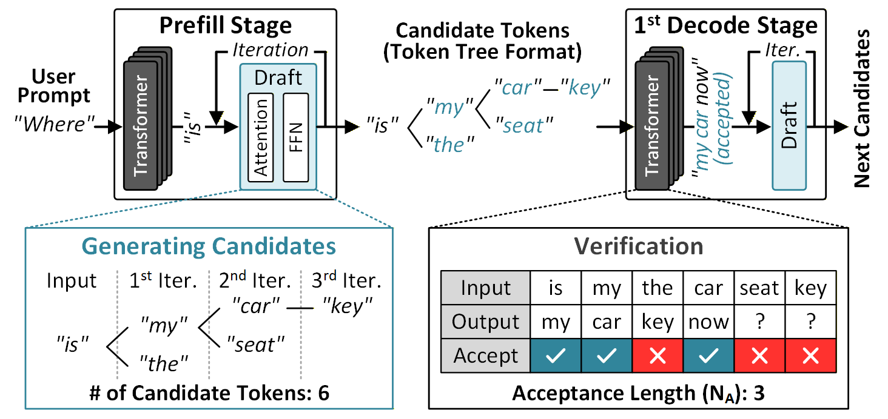

图里的 `"is → my → car"` 与 `"is → the → seat"` 是不同续写路径。验证时使用 tree attention，让节点只看到当前前缀及自己路径上的祖先，不会把另一条分支当成已经生成的历史。图中同时处理多个分支，但最终只沿符合验证结果的连续路径推进；这也是为什么同深度候选最多只保留一个。[1，§II-B]

Dense 模型每轮基本都读取同一套权重，多验证几个候选，在访存受限时容易摊薄成本。MoE 则不同：分母 $N_A$ 变大时，分子 $B_{\mathrm{verify}}$ 也可能跟着涨。[1，§I；3，§3]

所以，**MoE 和推测解码不是天然不兼容，而是收益取决于联合验证的专家工作集是否膨胀。**

MoESD 恰好说明另一面：在 GPU 上，中等 batch size 的普通解码可能已经激活了大量乃至全部专家。这时再验证多个候选，额外权重加载反而有限，推测解码仍然可以获益。它与 EdgeXpert 并不矛盾，二者面对的工作点不同。[3]

## 3. 从现有工作看，EdgeXpert 补的是哪一块？

这里不把不同机器上的加速比排成一张“SOTA 榜单”。手机实测、GPU 卸载、专用硬件仿真，数字直接横比没有意义。更有用的是比较：**谁减少了哪一层的数据移动，付出了什么代价。**

### 3.1 缓存与路由优化：让下一次尽量别再搬

**Mixture of Cache-Conditional Experts** 把 cache 状态引入运行时路由：对已经驻留在快内存中的专家提高选择倾向，保留重要路由、调整低贡献路由，减少从慢存储换入专家。它是 training-free 的，也就是无需额外训练，但改变了运行时专家选择。[4]

**ReMoE** 把类似目标前移到微调阶段：冻结专家等非 router 参数，只微调 gate，用时间局部性目标鼓励相邻 token 复用专家，再用分布约束限制路由偏离原模型。部署时仍使用常规推理图，不必额外执行 cache-aware 重排策略。[5]

二者与 EdgeXpert 的共同点是：**不再把原始路由当成绝对不能动的结果，而是允许小幅质量取舍来减少数据移动。**

区别在于，前两者主要减少跨解码步的专家换入；EdgeXpert 的 prefill 策略是在同一个 prompt、同一层内缩小专家并集。这里的“shared expert set”是共享的**专家索引集合**，不是缓存了一整批专家权重，更不是模型架构里的 shared expert。

### 3.2 量化与剪枝：让每次搬的包裹变小

**EdgeMoE** 不只做量化，还包含端侧专家加载与缓存优化。EdgeXpert 的对比重点，是它基于专家重要性采用混合精度：部分专家用 4-bit，部分用 2-bit，降低专家权重 footprint 与读取成本。[1，§V-A；6]

**MoE-Pruner** 利用 router 提供的线索衡量专家内部权重的重要性，做细粒度非结构化剪枝。非结构化指保留的位置不必形成规则整块，因而需要相应的稀疏执行支持，才能把零权重转成真正的硬件收益。[7]

这些方法回答的是“专家本身能不能更小”。但多候选联合执行还有一个问题：**每个候选都只要一部分，所有候选合起来却可能把大部分都要了。**

### 3.3 MoE + 推测解码：最直接的邻居已经在处理专家膨胀

**MoESD** 分析 batch size、专家稀疏度和目标模型执行成本，寻找推测解码有收益的工作点。它不是靠近似路由来强行减少权重访问，而是解释什么条件下原有执行就能获益。[3]

**MoE-Spec** 更直接：每层对候选树的 router 分数做聚合，选出预算内的专家，只加载 shortlist。自然路由落在 shortlist 外的 token，可以截断缺失专家的贡献，也可以用 shortlist 内的其他专家替代。它主要限制**专家级**的验证工作集，并允许质量与速度之间的取舍。[8]

**SMoLPU** 是 EdgeXpert 最直接的硬件前序工作，发表于 ISSCC 2026。它针对 MoE 推测解码做 coarse-to-fine pruning：先剪冗余专家，再剪专家内部通道。EdgeXpert 沿用这一基础，再处理“剪掉的计算没有等比例变成少读的权重”以及 prefill 未被覆盖的问题。[1，§II-C]

| 工作 | 主要机制 | 主攻的成本 | 与 EdgeXpert 的区别 |
|---|---|---|---|
| Cache-Conditional Experts | 根据缓存驻留状态调整路由 | 慢存储→快内存的专家换入 | 依赖可容纳专家的缓存，侧重跨步复用 |
| ReMoE | 只微调 router，提高时间局部性 | 跨解码步重复加载 | 离线塑造路由轨迹，不针对候选树通道并集 |
| EdgeMoE | 混合精度及端侧专家管理 | 专家容量与读取成本 | 让专家更小，不直接解决同深度通道并集 |
| MoE-Pruner | router 引导的细粒度剪枝 | 参数量、运算与稀疏执行 | 静态权重稀疏不等于候选联合读取稀疏 |
| MoESD | 分析并选择合适工作点 | 联合验证效率 | 不修改原模型验证计算来压访存 |
| MoE-Spec | 候选树级专家预算 | decode 的专家级读取 | 不进一步处理专家内部通道联合加载 |
| SMoLPU | decode 的专家→通道两级剪枝 | 冗余计算与部分加载 | EdgeXpert 的直接基础，未充分覆盖 prefill 与通道 EMA |
| **EdgeXpert** | prompt 级复用 + 同深度通道合并 + 计算校准 | **prefill 专家 EMA、decode 专家内部 EMA** | 用运行时策略和专用数据通路，把稀疏转成实际少搬 |

因此，这篇工作的意义不在于宣称“此前没人做过 memory-efficient MoE”，而在于提出一个更具体的缺口：

> **当缓存不足以常驻多个专家、且推测验证把多 token 需求合并时，仅做缓存优化、专家预算或逐 token 通道剪枝，都未必足以降低片外访存。**

也不能据此说它全面超过上表所有工作。论文定量对比的是 MoE-Pruner、EdgeMoE 和 SMoLPU；其余是机制层面的 related work，没有同平台胜负证据。[1，§V-A]

## 4. Prefill：先让重要 token 建立专家集合，再给其他 token 复用

### 4.1 Token 重要性来自一个能看完整上下文的小 encoder

prefill 把 prompt 中的很多 token 一起送入模型。独立 Top-k 路由容易把专家并集撑大，但把所有 token 的预算一刀切降下来，又容易伤害关键语义。

EdgeXpert 使用约 23M 参数的 `all-MiniLM-L6-v2` 小 encoder。Encoder 使用双向 attention，可以同时看前后文；其中 `[CLS]` 是用于汇聚序列信息的特殊 token。作者用最后一层、跨 attention head 平均的 CLS attention，估计各输入 token 的重要性。[1，§III-A、§IV-B]

如下图，小 encoder 提供的是**重要性提示**，不是替大模型生成答案。得到重要性后，token 分为 major、minor、trivial 三组，分别接受不同路由预算。

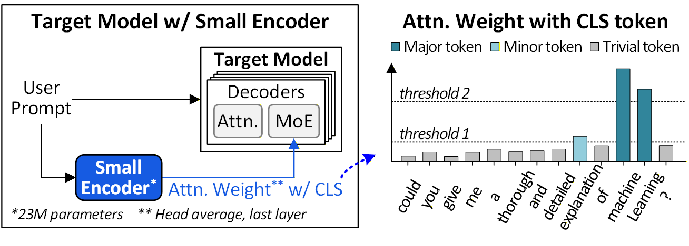

这里还有一个容易漏掉的工程细节：小 encoder 与目标 MoE 不一定使用相同 tokenizer，拆出的 token 个数和边界也不一样。

公开代码中的 `compute_prefill_token_importance()` 会取两套 tokenizer 的字符区间，把与某个 MoE token 区间重叠的 encoder token 分数收集起来，使用其中最大值映射重要性。它不是把两个不同长度的 attention 向量直接对齐。[9，`moe_prefill_utils.py`]

目标模型的因果 attention 只允许 token 看之前的位置。小 encoder 则能在 target 执行之前获得完整上下文的重要性估计，这才使 prefill 一开始就能使用访存感知策略，而不是先跑完大模型再决定省什么。

注意：**低重要性 token 没有被删除，原始输入序列也没有被改写。** 变化的是它在 MoE 层中使用哪些专家，以及使用多少个。[1]

### 4.2 扩大候选范围，却缩小实际执行预算

论文用 $k$ 表示候选专家范围，用 $n$ 表示最终路由数量。两个数字不是同一件事。

以 Qwen3 的论文配置为例：

| Token 分组 | 候选范围 $k$ | 实际执行 $n$ | 路由策略 |
|---|---:|---:|---|
| major | 8 | 8 | 保留原 Top-8，形成共享集合 |
| minor | 10 | 6 | 保留 Top-1，其余优先复用集合中的专家 |
| trivial | 12 | 4 | 保留 Top-1，进一步缩小预算、扩大复用候选 |

算法按组处理：major 先建立 $\mathcal E$；minor 在自己的候选范围里优先选 $\mathcal E$ 中的专家，不足时才按 router 排名补齐，并更新集合；trivial 再利用更新后的集合。[1，Algorithm 1、Table III]

如下图，trivial token 不是执行 Top-12，而是**从 Top-12 中找 4 个**。放宽候选范围，是为了增加遇到已经选过的专家的机会。

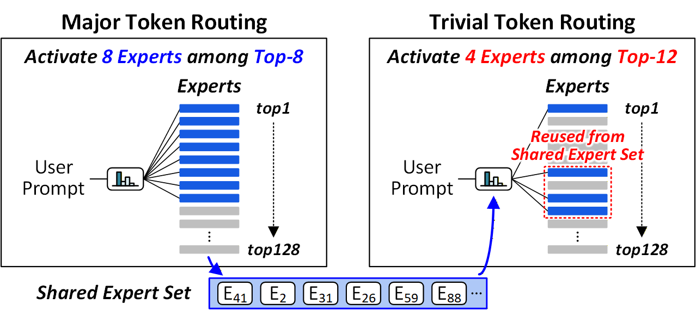

用一个简化例子走一遍，下面数字只是教学示意：

- 重要 token 建立共享集合 `{A,C,D}`；
- 某个 minor token 的排名为 `B,A,E,C,D,F`，需要 3 个专家；
- `B` 是 Top-1，先保留；
- 剩余两格从已有集合中按排名找，选到 `A,C`；
- 最后执行 `{B,A,C}`，而不是独立 Top-3 的 `{B,A,E}`。

`B` 仍可能带来新读取，但 `E` 的新增读取被避免了。这个机制不是强迫所有 token 用同一批专家，而是给次要路由增加一个“尽量复用”的偏好。

### 4.3 预算不能只凭感觉，要看输出误差与专家数的折中

作者比较改路由前后 MoE 层输出的归一化均方误差：输出差的平方和，除以原始输出的平方和，再对层和 token 取平均。这个误差越低，说明越接近原模型。

同时比较所有层激活的不同专家数之比，记作 $R_{\mathrm{EMA}}$，越低意味着专家级读取需求越小。严格说，它是专家数量代理指标，不能不考虑专家大小就当成通用字节数。

搜索时扩大 $k$、减少 $n$，选误差与访存代理指标之间的折中点。trivial 允许比 minor 更激进的误差预算；这是一套按模型校准的启发式，不是数学上保证最优的路由。[1，§IV-B]

硬件分组也没有对所有 token 做全局排序。它比较 token 分数与两个相对最大分数的阈值，再用重排网络把组内项聚在一起。硬件一次处理 128 个 token，采用三级流水线；更长 prompt 按块推进，避免跨块排序合并开销。[1]

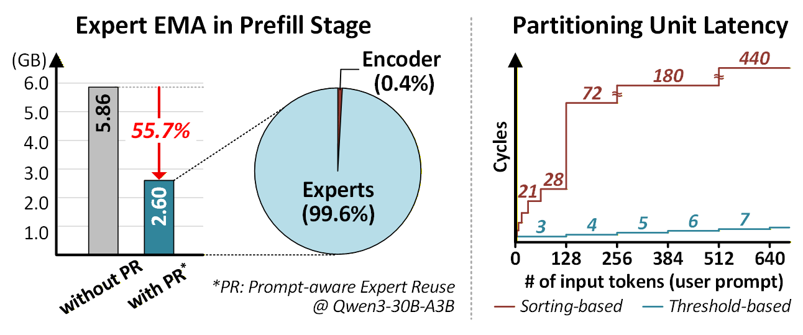

上图的 Qwen3 示例里，prefill 专家 EMA 从 5.86 GB 降到 2.60 GB，减少 55.7%；小 encoder 只占该图新增方案 EMA 构成中的约 0.4%。这说明重要性估计的额外开销能够被专家读取节省覆盖，**不是说完整系统能耗一律下降 55.7%**。

## 5. Decode：真正该合并的是通道读取需求，而不只是专家编号

### 5.1 逐 token 都剪了，硬件为什么还是要读很多？

通道可以理解为一个隐藏向量中的分量，以及线性变换中与这个分量对应的权重切片。

设两个候选进入同一个专家：

- token 1 只需要输入通道 `{0,2}`；
- token 2 只需要输入通道 `{1,2}`。

每个 token 都省了一部分乘加，但一起算时，硬件至少要读 `{0,1,2}` 对应的权重。**计算看各 token 自己的 mask，访存看所有 mask 的并集。**

如下图，原文示意里计算减少 62.5%，权重 EMA 却只减少 25%。这两个百分比对应图中的例子，不是整个系统的最终收益。[1，§IV-C]

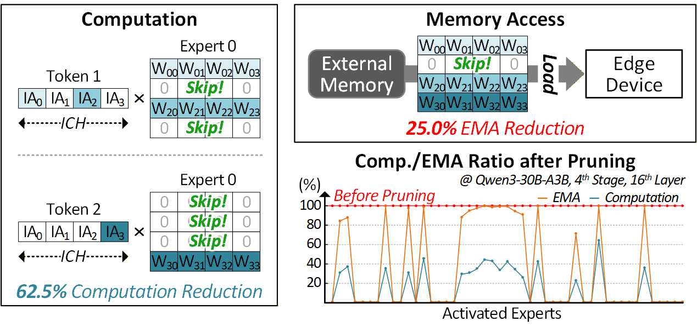

候选树越宽、各 token 的通道选择越不一样，并集越容易恢复成近乎稠密。这就是为什么已有 coarse-to-fine pruning 还不够。

### 5.2 同深度候选有共性，但最终最多只留一个

候选树的 depth 表示“距离当前前缀的第几步”，不是 Transformer 的第几层。

同一深度的候选通常位于相似的语法或语义位置。例如下面这些候选可能都在给同一句话补介词，于是有机会路由到相同专家。原文 Qwen3 分析中，同深度候选共享至少 3 个所选专家的比例，在某些层与深度组合上最高达到 88.4%。**这不是说 88.4% 的全部通道都可以共用。**[1，§III-B]

另一方面，单请求的树验证最终只接受一条连续路径，因此**每个深度最多接受一个候选，也可能一个都不接受**。验证前为大量同深度候选读入的通道，事后可能只服务了被丢弃的分支。

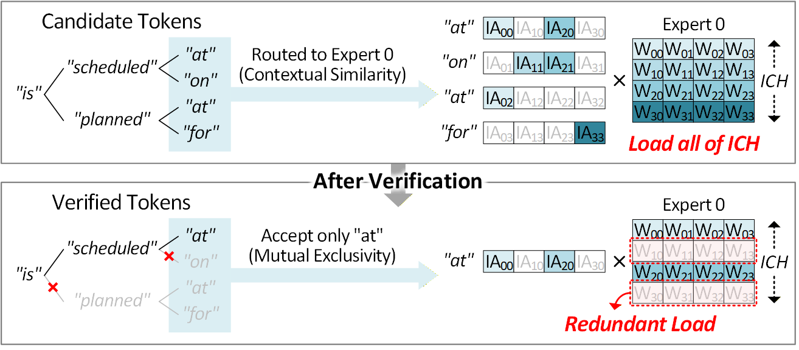

图的上半部分为 `"at"、"on"、"at"、"for"` 的不同候选服务，通道并集很大；下半部分验证后只保留一条路径上的 `"at"`，其他分支用到的不少数据都白搬了。

不过，不能倒过来说“它们最后会丢弃，所以现在随便算”。**验证前并不知道谁会留下，而近似计算本身也可能改变验证结果。** 同深度互斥提供的是优化机会，不是精确性的证明。

### 5.3 用两个分数决定加载哪些通道

EdgeXpert 的 depth-aware expert coalescing，按深度感知的专家通道合并，对进入同一专家、同一候选深度的 token 做需求汇总。

设某组候选为 $\mathcal T_{d,e}$，$x_{t,c}$ 是 token $t$ 的通道 $c$ 激活，$a_t$ 是 attention 派生的重要性权重，$m_{t,c}$ 是基础通道剪枝 mask，1 表示该 token 原本要计算此通道。

用本文统一记号，原文的两个分数可写为：

$$
S_C(c)=\sum_{t\in\mathcal T_{d,e}} |x_{t,c}|\,a_t,
$$

$$
S_S(c)=\sum_{t\in\mathcal T_{d,e}} m_{t,c}|x_{t,c}|\,a_t.
$$

前者汇总所有候选在该通道的加权幅度，后者只统计 mask 标为需要计算的部分。它们不是使用未来答案算出的“真正贡献”，而是运行时可获得的代理分数。

当通道有实际需求、且显著性满足约 $S_S(c)>sr\cdot S_C(c)$ 的条件时加载，其他通道跳过。$sr$ 是 0 到 1 之间的选择阈值，越高通常越激进；它不是“直接保留 $sr$ 比例的通道”。边界相等、always-keep 保护等实现细节，需要以代码为准。[1，§IV-C；9]

如下图，左侧先筛选读取集合，右侧再改变计算 mask。两个步骤不能混成一个。

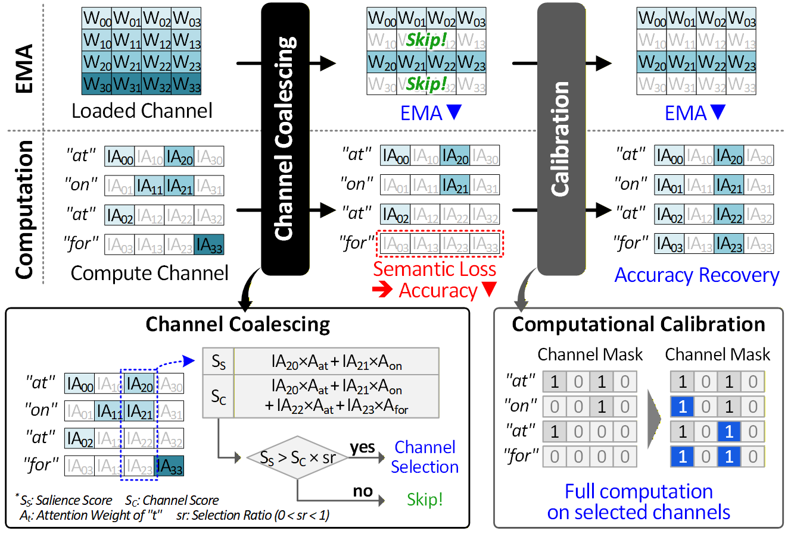

走一个教学例子：某通道在两个候选上的加权幅度都是 5，但只有第一个候选的原 mask 为 1。那么 $S_C=10$、$S_S=5$；取 $sr=0.9$ 时，5 小于 9，这个通道可能被跳过。它确实省了读取，代价是第一个候选丢掉了原本需要的信息。

如果二者原本都需要这个通道，$S_S=S_C=10$，它就更容易留下。**合并在偏好共同、显著的需求，而不是把完整并集原样读入。**

阈值通过 calibration set——少量用于确定参数的校准样本——选择。作者比较最终被接受 token 的原始通道集合与合并集合的重叠比例，要求平均 channel coverage 高于 75%。这是集合覆盖指标，越高代表原需求保留越多，不是“正确率至少 75%”的保证；它也是离线调阈值的指标，运行时没有偷看未来答案。[1]

## 6. 少读造成的质量损失，用“已读数据多算一点”补回来

Channel coalescing 的问题很直接：某个 token 需要的通道被丢掉，隐藏表示会变差，draft 候选与 target 输出更难对齐，平均接受长度也可能下降。

接受长度下降，就要多跑几轮 target。省下的每轮访存，会被额外轮数吃回去。

EdgeXpert 用 **computational calibration，计算校准** 修复这个问题：在论文设计中，同组候选不再只计算自己原 mask 与已加载通道的交集，而是尽量利用已经加载的通道。某个通道原本是为其他候选留下的，现在也可以参与当前候选的计算。[1，§IV-C]

还是前面的例子：

- token A 原需求 `{0,2}`；
- token B 原需求 `{1,2}`；
- 合并后加载 `{1,2}`。

没有校准时，A 只能算 `{2}`，丢掉通道 0 的信息。

校准后，A 可以在 `{1,2}` 上算。**它没有把没加载的通道 0 变回来**，只是使用现有通道提供部分替代信息，降低输出偏差。这是一种经验有效的近似修复，不是精确重建原输出。

额外乘加不用额外片外读取。如果系统的主要瓶颈是访存，那么多算一点可能比再搬一轮便宜得多。反过来，在计算受限的硬件或很大 batch 下，这个交换未必划算。

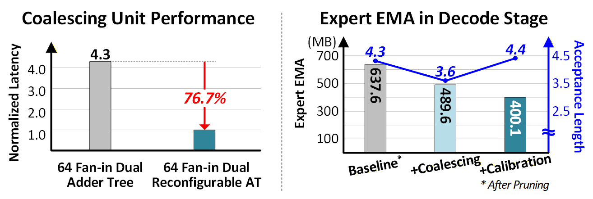

上图右侧的 Qwen3 示例，把这种反直觉的交换展示得很清楚：coalescing 后每轮读取虽然少了，接受长度也从 4.3 降到 3.6；加上校准后，接受长度恢复到 4.4，完成同样输出所需的轮数减少，累计专家 EMA 进一步下降。[1]

**真正该优化的是“最终输出 token 的摊销访存”，不是孤立地追求单轮最少读取。**

## 7. 为什么需要软硬件协同，而不只是一个 PyTorch mask？

### 7.1 数据流必须在读取前决定，而不是读完再乘零

如下图，EdgeXpert 包含指令与控制模块、512 KB 全局 SRAM、向量执行单元和 8 个计算 cluster。SRAM 是芯片内部的快速存储，但面积昂贵；512 KB 指的是全局共享 SRAM，不是整颗芯片全部 SRAM，cluster 内还各有输入与权重缓冲。[1，§IV-A、Table V]

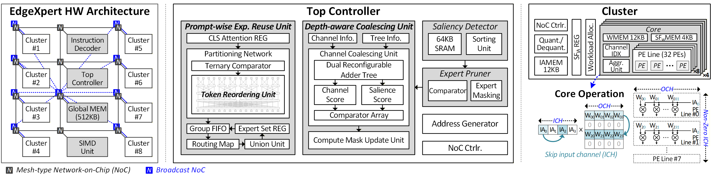

它没有靠“把所有热门专家缓存下来”省访存。论文以 DeepSeek-V2-Lite 为例，一个 4-bit 专家就约 4 MB，超过全局 SRAM 的规模。执行时只能流式载入权重块，先把路由到当前专家的 token 处理完，再推进到其他专家。

端到端主线是：

1. **prefill 前**：小 encoder 生成 token 重要性，映射到目标模型 token；
2. **每个 MoE 层**：router 产生分数，按组形成最终专家路由；
3. **prefill 执行**：加载同一专家权重时服务多个 token，通过片上互连广播提高复用；
4. **draft 阶段**：轻量模块生成候选树；
5. **target 验证的每个 MoE 层**：按专家和候选深度汇总通道需求，生成加载与计算 mask；
6. **decode 执行**：只请求选定通道对应的权重切片，对已经读取的数据做校准后的计算；
7. **验证结束**：接受连续路径，更新历史状态，开始下一轮。

这里的关键边界在第 5→6 步：**mask 必须参与地址生成与内存请求，才会真的少读。** 如果先把整个矩阵读进来，再在 PyTorch 里 `x * mask`，只能表达近似算法，不能自动证明 EMA 减少。[1，§IV]

### 7.2 输入通道稀疏，输出方向连续，才能避免碎片访存

用 Qwen3 的公开配置和 artifact 中的专家实现核对，一个专家接收隐藏维度 2048 的输入，经 gate/up 两个投影变成 768 维中间表示，再通过 down 投影回到 2048 维：

$$
X[T,2048]
\longrightarrow
\operatorname{SiLU}(XW_g^\top)\odot(XW_u^\top)[T,768]
\longrightarrow
Y[T,2048].
$$

SiLU 是门控中的非线性激活，$\odot$ 是逐元素相乘；$T$ 是路由到当前专家的 token 数。比如 $T=4$，输入就是 `[4,2048]`，不是每个专家都有整棵树的全部 64 个 token。[9][10]

按 PyTorch 的 `[输出维,输入维]` 约定，gate/up 权重各为 `[768,2048]`，down 为 `[2048,768]`。剪 gate/up 的输入通道与剪 down 的输入通道，作用在不同维度，不能统称“剪掉同一个隐藏维度”。

论文的硬件存储与读取布局沿输出通道方向组织连续权重，对选定的输入通道进行加载，避免逐标量、不规则地访问 DRAM。**PyTorch 参数矩阵的逻辑 shape，不等于加速器的物理存储布局。**[1，§IV-A、§V-B]

此外，同深度候选数不固定，分数汇总使用双可重构加法树，可同时处理多个 depth group，降低固定加法树在小组上的闲置。原文对比中，该单元时延降低 76.7%，但这是 coalescing 单元的局部指标，不能当成端到端加速比。[1，§IV-C]

## 8. 实验有收益，但“接近原始精度”不等于无损

### 8.1 先看实验口径：综合与仿真，不是流片实测

论文评估四个模型：Granite-1B-A400M、OLMoE-1B-7B、DeepSeek-V2-Lite、Qwen3-30B-A3B。推测框架采用 EAGLE-3，每轮 64 个候选，最大深度 6。

硬件条件为：

- Samsung 28nm 工艺，800 MHz；
- A8W4，即 8-bit 输入激活、4-bit 权重；
- 8K 乘加单元，峰值 13.1 TOPS，表示每秒约 13.1 万亿次基本运算；
- 片外带宽 16 GB/s；
- 逻辑综合、时序与功耗分析，结合指令级自定义模拟器估算端到端时延和能耗。

**这不是制造出的 EdgeXpert 芯片在手机上的实测。** 面积也包含按 60% 单元利用率投影的逻辑面积与 SRAM 宏面积，不能把它写成已经完成布局布线验证的量产芯片指标。[1，§V-A]

### 8.2 最大收益必须带上对照对象

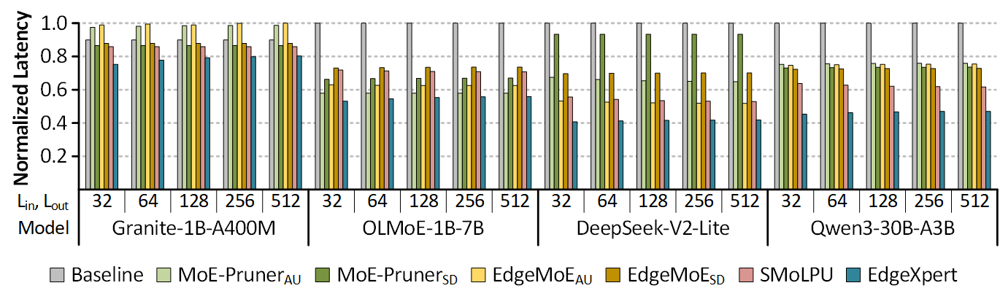

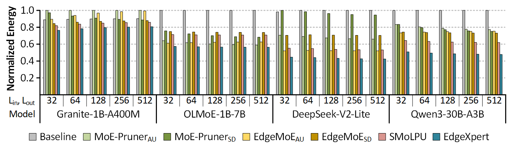

原文相对已有基线报告 **最高 56.3% 端到端时延降低、最高 44.1% 能耗降低**。最高值不是所有模型、所有长度的平均值；“时延降低 56.3%”也不能改写成“加速 56.3 倍”。[1，§V-B]

尤其要注意 baseline 映射：

- SMoLPU 从原频率归一到 800 MHz；
- EdgeMoE 原本基于 Jetson，论文把它的混合精度策略映射到专用硬件后端，而不是拿整板功耗硬比；
- MoE-Pruner 使用支持任意跳过的硬件映射，且论文关闭了其可选的剪枝后微调。

这种归一化有助于比较架构效率，但也意味着结果带有后端映射与模拟假设。不能说“在真实 Jetson 上超过 EdgeMoE 56.3%”。[1]

首 token 等待时间记作 **TTFT，time to first token**，越低越好；生成阶段平均每个输出 token 所需时间记作 **TPOT，time per output token**，同样越低越好。二者不能简单互相替代：prefill 优化主要影响前者，decode 优化主要影响后者。

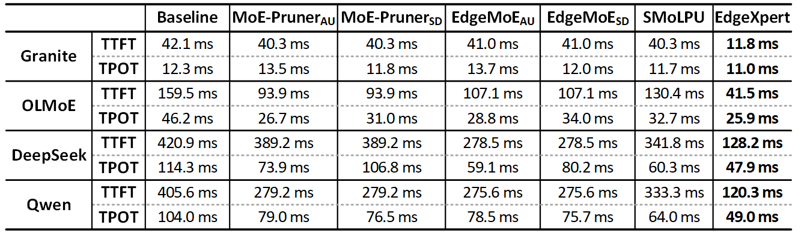

原文表中的 DeepSeek-V2-Lite，EdgeXpert 为 TTFT 128.2 ms、TPOT 47.9 ms；Qwen3 为 120.3 ms、49.0 ms。论文用 TTFT <450 ms、TPOT <50 ms 作交互目标。它们是本评估采用的阈值，不是所有端侧应用都必须遵守的通用标准。[1]

### 8.3 质量恢复有任务差异，推理任务值得单独看

MT-Bench 是多轮对话质量评分，GSM8K 是小学数学应用题正确率，MMLU 是多领域知识问答正确率，PIQA 是物理常识问答正确率；下面都越高越好。Baseline 在原文质量表里已经包含 SMoLPU 的基础剪枝，不是未经剪枝的原始模型。

| Qwen3-30B-A3B 配置 | MT-Bench | GSM8K 非 thinking | GSM8K thinking | 平均接受长度 |
|---|---:|---:|---:|---:|
| Baseline | 8.8 | 72.8% | 87.3% | 4.3 |
| 加 prompt 级复用 | 8.7 | 72.8% | 87.3% | 4.3 |
| 再加通道合并，未加校准 | 5.8 | 66.8% | 76.1% | 3.6 |
| 完整 EdgeXpert | 8.7 | 69.4% | 88.0% | 4.4 |

thinking 指启用较长的中间推理过程。完整方案把大部分损失补回来了，但非 thinking 的 GSM8K 仍下降 **3.4 个百分点**。MMLU 从 76.2% 到 74.4%，PIQA 从 79.2% 到 76.1%。因此，“near-baseline”可以作为总体描述，**“不掉精度”不准确**。[1，Table IV]

thinking 的 GSM8K 从 87.3% 到 88.0%，说明该评估中没有观察到下降，不代表近似方案必然改善推理。论文也没有给出让这 0.7 个百分点可以被解释为稳定增益的统计证据。

标准推测解码在保持原 target 验证分布、正确使用接受与修正机制时，可以保持输出分布不变。但 EdgeXpert 改了 target 的路由与通道计算，不能再借用那个保证：**它是用实测任务质量约束近似误差，不是对原模型无损。**

## 9. 可复现性和适用边界，比“又一个省内存方案”更值得讨论

### 9.1 公开 artifact 证明算法可检查，不自动复现硬件曲线

作者在 Zenodo 提供了软件 artifact，包含各优化策略、统一 `run.py` 入口及 GPU 显存测量辅助脚本。论文说明它运行在 bf16——一种 16-bit 浮点格式——而论文报告的硬件评估使用 A8W4。[9]

阅读代码还能发现复现时必须对齐的细节：

- 论文候选树最大深度是 6，公开入口默认 `--depth` 为 10；
- 论文 Qwen3 重要性阈值为 0.80/0.55，入口默认是 0.75/0.35；
- artifact 默认 Qwen 模型路径指向 `Qwen3-30B-A3B-Instruct-2507`，不能只凭“Qwen3”这个简称就假定与每项论文结果完全一致。

所以，直接运行默认命令得到一段文本，并不等于复现了论文质量表，更不等于复现了 28nm 硬件的 EMA、时延和能耗。本文对代码做了静态核对，未运行模型或完整 benchmark。

还有一个应进一步核查的实现细节：公开路由 helper 在完成小预算选择后，有把结果补回固定 `max_k` 长度并填写非零权重的逻辑；它与论文算法“minor 最终 6 个、trivial 最终 4 个”的语义是否一致，需要跟踪后续剪枝与实际访问轨迹。仅看输出 tensor shape 不能断言预算已经落地，也不能仅凭静态阅读就给出完整复现结论。[9]

### 9.2 它最适合的，不是所有 MoE 部署

这套设计的主要收益来自三个条件：

1. **片外访存主导**：少读比少算更值钱；
2. **片上缓存很小**：很难常驻多个完整专家；
3. **同深度候选存在足够复用**：合并需求不会过度伤害真正被接受的路径。

如果专家长期驻留在快内存里、batch 很大导致计算主导，或者候选之间的通道需求差异特别大，收益可能缩水。长上下文时，KV cache——保存历史 token 的 attention key/value、避免反复计算的缓存——也可能成为主要瓶颈；不能把本文短上下文端侧的权重瓶颈直接推广过去。[1]

与量化、缓存和更好的 draft 理论上存在组合空间，但不能假定加速倍数直接相乘。更好的 draft 会改变候选树、接受长度和专家工作集；更强的通道剪枝也会改变 coalescing 的输入。**组合后需要重新校准和端到端评估。**

### 9.3 MICRO 视角下，贡献是把近似算法落实到内存请求

单看算法，prompt 级复用与 expert budgeting 并非完全陌生；同深度候选冗余也不是一个孤立的新概念。

更完整的贡献链条是：

**定位专家与通道并集膨胀 → 修改路由和加载集合 → 用已加载通道修复接受长度 → 设计分组、汇总、地址生成与执行数据流 → 用统一硬件条件评估。**

这解释了它作为微体系结构论文的意义：不只证明模型里存在冗余，还说明**在哪个硬件边界之前消除冗余，才能真正少发内存请求**。[1][2]

评价上最有说服力的部分，是“计算稀疏未必变成访存稀疏”这个瓶颈与双阶段方案的对应关系；仍需要谨慎的部分，是近似质量的任务敏感性、仿真与真实系统之间的差距，以及公开 artifact 与论文配置的对齐。

## 10. 总结

MoE 的优势是稀疏激活，但稀疏激活只描述单个 token。把多个候选联合验证之后，硬件面对的是专家集合与通道集合的并集。

EdgeXpert 把这件事分成两层解决：

- **prefill** 用重要性驱动的 prompt 级路由，让次要 token 优先复用已有专家；
- **decode** 利用同深度候选的相关性与互斥性，缩小通道读取集合；
- **计算校准** 用已经读入的通道多算一点，避免接受长度下降抵消访存收益；
- **专用数据流** 让 mask 在权重读取之前生效，而不是读完再跳算。

它不是把 memory-efficient MoE 重新发明一遍，也不是一个通用的“无损省显存插件”。它给这个已经很拥挤的方向补上了一个具体问题：

**省参数、省乘加、省单轮读取，最后都要回到同一本账——为每个最终输出 token，到底搬了多少数据，又付出了多少质量代价。**

---

## 参考资料

1. [EdgeXpert 原文 v1](https://arxiv.org/html/2608.05303v1)，主要依据 §I–V、Tables III–V 与 artifact 附录。
2. [MICRO 2026 官方主程序](https://microarch.org/micro59/program/)，核实会议日期、论文与 session。
3. [MoESD: Unveil Speculative Decoding’s Potential for Accelerating Sparse MoE](https://arxiv.org/html/2505.19645)，使用检索时可访问的 v4，重点是中等 batch 的工作点分析。
4. [Mixture of Cache-Conditional Experts for Efficient Mobile Device Inference](https://arxiv.org/html/2412.00099)，运行时缓存感知路由。
5. [ReMoE: Boosting Expert Reuse through Router Fine-Tuning in Memory-Constrained MoE LLM Inference](https://arxiv.org/html/2605.27081)，router 微调与时间局部性。
6. [EdgeMoE: Empowering Sparse Large Language Models on Mobile Devices](https://arxiv.org/html/2308.14352)，混合精度、专家管理与端侧部署。
7. [MoE-Pruner: Pruning Mixture-of-Experts Large Language Model using the Hints from Its Router](https://arxiv.org/html/2410.12013)，router 引导剪枝。
8. [MoE-Spec: Expert Budgeting for Efficient Speculative Decoding](https://arxiv.org/html/2602.16052)，候选树级专家预算。
9. [EdgeXpert 软件 artifact](https://doi.org/10.5281/zenodo.21481269)，静态核对 `run.py`、`moe_prefill_utils.py`、`eagle_qwen/model/modeling_qwen3_moe_kv.py`；未运行评估。
10. [Qwen3-30B-A3B 官方配置](https://huggingface.co/Qwen/Qwen3-30B-A3B/blob/main/config.json)，核对隐藏维度、专家中间维度和专家数量。

文中论文图片来自 EdgeXpert 原文，版权归原作者；示意集合和算术例子为本文解释，不是新增实验。SMoLPU 的方法介绍与归一化比较口径依据 EdgeXpert 对该前序工作的描述；未把不同平台的原始数字用于跨平台排名。

---

顺带一提，MoE 访存优化和模型压缩的目标相近，但切入点不同：前者在意“什么时候搬、搬哪些”，后者更多在意“模型本身能不能更小”。我们在《动手学 AutoML：从 NAS 到大语言模型优化实战》中整理了 NAS、LLM 架构自动化、剪枝、量化与后训练剪枝实战。书里不直接覆盖本文这种 MoE 候选树和加速器数据流设计，但如果想把 LLM 压缩这条相邻路线系统补起来，可以接着看。

> 
