# arXiv'26 | VoxCanvas：语音编辑的 4100 万对数据怎么造，模型又该怎么训？

> 原文：[VoxCanvas-41M: A Large-Scale Bilingual Dataset for Instruction-Based Speech Editing and Its Learning Dynamics](https://arxiv.org/html/2611.08251v2)
>
> [数据集](https://huggingface.co/datasets/zkniu/VoxCanvas) · [数据构建代码](https://github.com/ZhikangNiu/VoxCanvas) · [音频演示](https://zhikangniu.github.io/voxcanvas/)

---

## 1. 语音编辑不缺录音，缺的是“只改了指定内容”的录音对

一段播客已经录好，才发现把“周四开会”说成了“周五开会”。重新录一句再拼进去，音色、语气、背景噪声可能接不上；让模型重新念整段，原来的停顿和重音又可能一起丢掉。

理想的操作是直接告诉模型：“把‘周五’改成‘周四’。”它负责找到位置、生成新声音，并尽量不动其他内容。

**语音编辑的难点，不只是把新词念对，而是同时满足“该改的改对，不该改的保留”。** 这比普通的 TTS（text-to-speech，文字转语音）多了一层约束。

过去常见的方案是 masked infilling：把待修改的一段声音遮住，再根据修改后的全文和周围声音补洞。训练很方便，有录音和转写就可以随机挖洞；使用却不够方便，因为系统需要知道两件事：**修改后的全文是什么，要重新生成哪段声音。**

为此，通常先做 ASR，即自动语音识别，再用 forced alignment（强制对齐）把已知文字对应到录音里的时间区间。认错词或对错边界，后面的生成就跟着出错。

指令式编辑把接口变成：

$$
\text{原录音}+\text{自然语言指令}\longrightarrow\text{编辑后的录音}
$$

用户不用先交出改后的全文和精确时间戳，但定位、理解和保留这些工作并没有消失，而是需要模型自己学会。相应的训练样本也不能只有“声音—文字”，必须是：

$$
\langle x_{\mathrm{src}},c,x_{\mathrm{tgt}}\rangle
$$

三个量分别是源录音、编辑指令、正确的目标录音。

问题就出在目标录音。找同一个人把修改前后各读一遍，两次的语速、停顿和环境也不会完全一致；剪切拼接真实录音，又只能利用录音里已有的词，还容易留下接缝。模型看到的变化不只来自编辑，很难知道到底应该学哪部分。

VoxCanvas 围绕这个问题做了两件事：

1. **造监督：**把普通录音加工成约 4100 万对中英语音编辑数据，覆盖基本改词、多位置修改和非语言声音编辑。
2. **研究怎么学：**固定模型框架，比较数据规模、任务配比、生成预训练和训练顺序，观察不同能力如何形成。

**这是一篇以数据和训练规律为主的论文，不是重新发明语音生成架构。** 用于验证数据的 VoxCanvas-Edit，来自已有 AuK 模型的微调。把这点分清，后面就不会把“数据怎么造”和“最终模型怎么编辑”混成一条 pipeline。

## 2. 先造出可控修改，再把真实录音放到目标端

### 2.1 从普通录音到编辑对，每一步都在减少监督噪声

下面是完整的数据构建流程。读图时抓住主线：**收集录音 → 重新转写并对齐 → 生成编辑指令和新文字 → 局部合成 → 过滤。** 图中的语音合成模型是造数据的工具，不是最终训练出来的编辑模型。

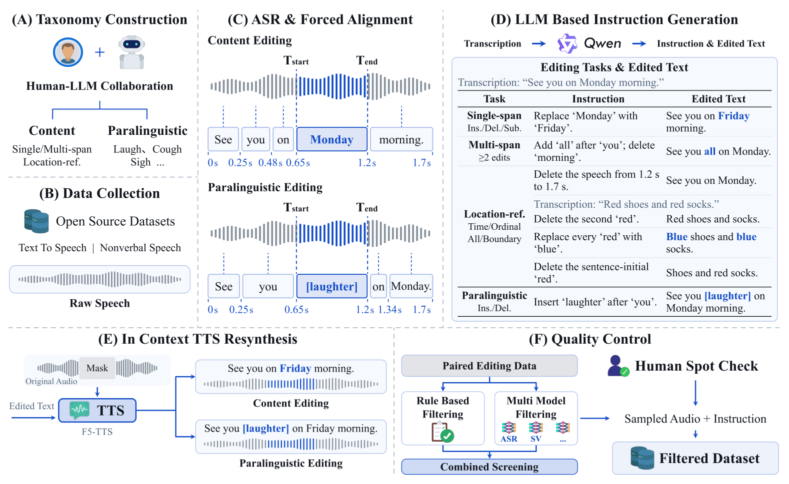

**第一步：重新转写，再定位。** 内容编辑使用 Emilia 的中英文录音，笑声、咳嗽等非语言声音来自六个已有语料库。作者用 Qwen3-ASR-1.7B 重新识别，再用 Qwen3-ForcedAligner-0.6B 获得词级时间戳。名称里的 B 表示十亿参数，两个模型分别约有 17 亿和 6 亿参数。

为什么不直接用已有转写？因为同一份文字既要用来定位编辑区间，又要用来合成目标。标注本身错了，后面即使完美执行，也是在制造错误监督。附录的对照实验显示，重新转写降低了生成内容的识别错误率，但没有同步提高所有音质指标，不能泛化成“全面改善声音质量”。

**第二步：规则选位置，语言模型生成新内容。** 删除可以直接移除选中的文字；插入和替换由 Qwen3.6-35B-A3B 根据原句和选中位置补充新内容，要求改后的句子通顺、连贯。最终指令再用预设模板组装。

例如，真实录音是“我们周四开会”，选择“周四”作为编辑对象，生成“周五”，再组装“把‘周四’改成‘周五’”。因此，**4100 万对数据不等于 4100 万种自由表达的用户指令。** 内容可以变化，指令仍然带有模板分布。

多位置任务在一条指令里安排 2—6 次插入、删除或替换，区域不能重叠。位置引用则支持“第二个词”“所有出现位置”“句首句尾”“第几秒”等定位方式。

**第三步：只在编辑附近重新合成。** F5-TTS 根据修改后的全文和周围音频，补全遮住的区域。每个区域向左右各扩展 0.5 秒，给连读、停顿和过渡留出空间。只按严格词边界替换，内容可能对了，接缝却很明显。

论文描述扩展区外保持原音频；[公开合成实现](https://github.com/ZhikangNiu/VoxCanvas/blob/main/src/voxcanvas/synthesize.py)则保留未遮罩的 mel 声谱条件，再用 Vocos 将完整声谱还原成波形。mel 声谱是声音在各频带上的能量表示，Vocos 是把这种表示恢复成声音的解码器。**保留声谱上下文，不等于保证区外波形逐个采样点不变。** 这是论文描述与当前工程实现需要区分的地方。

**第四步：合成后验收。** 自动过滤有三个关口，之后再人工随机抽查：

| 关口 | 保留条件 | 主要排除什么 |
|---|---|---|
| 时长 | 合成录音不超过 30 秒 | 过长或异常输出 |
| 文字 | 英文词错误率 WER 为零；中文拼音错误率 PER 为零 | 漏词、错词、多词 |
| 说话人 | 源录音与合成录音的声音身份相似度大于 0.5 | 音色明显漂移 |

WER 统计把识别结果改成标准文字需要多少次词级插入、删除和替换，再除以标准词数，越低越好；PER 把比较单位改成拼音，避免汉字不同但发音相同的样本被误删。声音身份相似度则用 WavLM 提取的向量比较，越高表示说话人越一致，0.5 不是“身份准确率 50%”。

对笑声等非语言编辑，文字过滤只检查说话内容有没有被破坏。**识别文字全对，不能证明笑声插对了或咳嗽删干净了。** 自动验收的覆盖范围，要和任务目标分开看。

### 2.2 同一对声音，反过来训练，监督质量就不同了

即使通过过滤，合成声音仍可能有细微接缝或韵律伪影。若训练方向是“真实录音 → 合成录音”，模型除了学会改词，也可能学会模仿目标里的伪影。

作者的关键处理是 **pair reversal，编辑对反转**：

$$
(\text{真实录音},\text{正向指令},\text{合成录音})
\longrightarrow
(\text{合成录音},\text{逆向指令},\text{真实录音})
$$

还是刚才的例子：

| 环节 | 输入 | 指令 | 目标 |
|---|---|---|---|
| 构造数据 | 真实：“我们周四开会” | 周四改成周五 | 合成：“我们周五开会” |
| 最终训练 | 合成：“我们周五开会” | 周五改成周四 | 真实：“我们周四开会” |

**合成声音提供可控的输入变化，真实录音提供更干净的输出监督。** 造数据时的插入，在反向训练时就变成删除；删除则变成插入。看代码里的操作标签，必须区分构造方向和训练方向。

单位置、多位置和非语言声音编辑采用反转；位置引用编辑保留正向。比如删除 3—5 秒的声音后，后面的时间轴已经前移，直接把指令倒过来不一定能可靠恢复原录音。

下面的对照实验固定同一个 TTS 初始化，平衡训练三种基本操作 5 万步，只改变正向、反向或两者混合。左图的 SIM 是说话人相似度，右图的 UTMOS 是模型预测的主观音质评分，两者都越高越好。

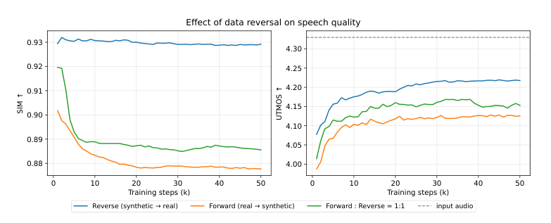

蓝色反向训练保留了更高的说话人相似度，音质评分也优于正向和混合。它支持的是**真实目标能减轻合成监督带来的声学退化**，不是所有任务的编辑准确率都一定随之上涨。

### 2.3 4100 万对覆盖什么，不覆盖什么

插入、删除、替换各约 1000 万对，多位置编辑约 1000 万对；四类位置引用各约 10 万对，非语言声音插入和删除各约 21 万对。中英文各约 2050 万对，都是论文给出的近似规模。

下图从左到右展示录音时长、多位置操作数量、编辑文字长度和非语言事件分布。能看出两点：**多位置任务主要集中在两三次修改；非语言事件有明显的长尾，类别多不代表样本均衡。**

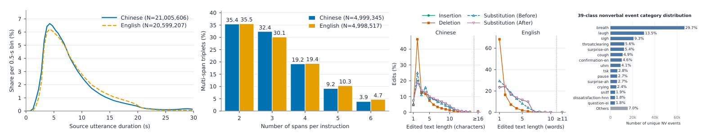

这里的非语言编辑覆盖 39 类发声事件，例如笑声、叹气、咳嗽。它不等于任意声学编辑：情绪、说话风格修改和依赖历史的多轮编辑，不在这份数据的当前覆盖范围里。

## 3. 数据造好后，AuK 如何把指令变成编辑后的声音

VoxCanvas-Edit 使用 AuK 的现有框架。输入是**待编辑的完整录音和指令**，输出是编辑后的完整录音。不是用户先给一个局部遮罩，模型再补洞。

为什么需要两种音频表示？因为“录音说了什么”和“录音听起来怎样”不是同一种信息。前者帮助模型找到并理解内容，后者承载音色、节奏和声学细节。单靠文字条件，无法保留原声音；单靠声学表示，也不足以执行自然语言要求。

下面是 [AuK 官方仓库](https://github.com/Tencent-Hunyuan/AuK)提供的基础架构图，不是 VoxCanvas 新提出的结构。左边看完整数据流，中间和右边是生成骨干内部的两种模块。

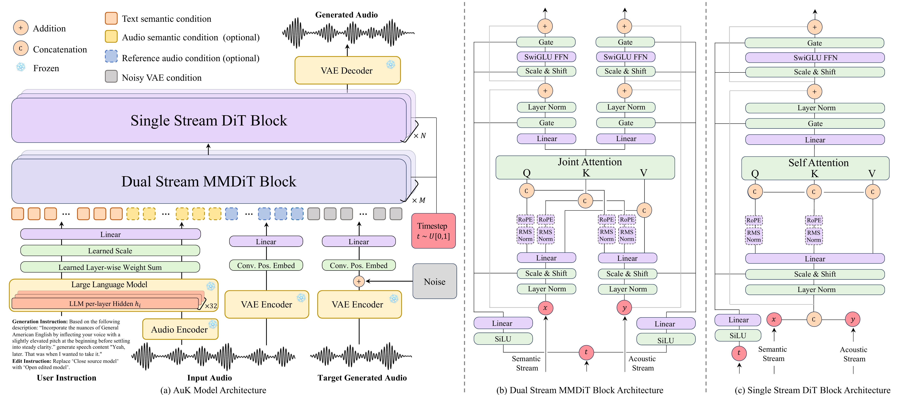

### 3.1 两条条件路径，最后进入同一个生成骨干

**语义路径：原录音和指令 → Qwen2.5-Omni → 语义特征。** Qwen2.5-Omni 是能联合处理声音和文字的多模态模型，在这里冻结其编码器权重。公开实现将各层隐藏状态归一化后，用可学习权重融合，而不只是取最后一层。

**声学路径：原录音 → 音频 VAE → 连续声学隐变量。** VAE 是变分自编码器，在这里把高采样率波形压缩成较短的向量序列，再提供反向解码能力。

用 10 秒录音走一遍尺寸，下面以公开 AuK 基础版为例：[模型配置](https://huggingface.co/tencent/AuK/blob/main/config.yaml)和[骨干源码](https://github.com/Tencent-Hunyuan/AuK/blob/main/src/auk/model/flux2_edit.py)可直接核对。

| 数据流 | 张量形状 | 含义 |
|---|---|---|
| 原始波形 | `[1, 1, 240000]` | 一条单声道录音，每秒 24000 个采样点 |
| VAE 编码 | `[1, 500, 64]` | 下采样 480 倍，每秒 50 帧，每帧 64 维 |
| 语义特征 | `[1, L, 2048]` | L 是声音与指令组成的条件序列长度，不等于 500 |
| 语义投影 | `[1, L, 1536]` | `Linear(2048, 1536)` 后归一化 |
| 声学投影 | 每帧 64 维 → 1536 维 | 源隐变量和含噪目标共享投影，并加入位置信息 |

假设目标长度分配为 520 帧，源音频的 500 帧和含噪目标的 520 帧沿时间轴拼接，得到 `[1, 1020, 1536]` 的声学流。语义流与它先经过 10 个双流 MMDiT 块，再经过 20 个单流 DiT 块。

MMDiT 是多模态扩散 Transformer：语义和声学保留各自的处理路径，但通过联合注意力交流。DiT 是扩散 Transformer，后续将两条流合在一起处理。输出映射回 64 维，并取目标部分交给 VAE 解码。

**造数据时的 F5-TTS 局部补洞，与最终 AuK 的完整目标生成，是两个不同环节。** 后者依靠训练学会保留，而不是直接把原始波形的未编辑区域硬拷贝到输出。

### 3.2 生成的不是文字，而是从噪声到目标声音的“移动方向”

生成骨干使用 flow matching，即流匹配：给定源声音和指令，学习怎样把随机噪声逐渐变成目标录音的声学隐变量。

设噪声是 $z_0$，真实目标的隐变量是 $z_1$，在二者间取一个中间状态：

$$
z_t=(1-t)z_0+t z_1
$$

$t=0$ 是噪声，$t=1$ 是目标。模型预测当前状态应该往哪里移动，训练目标是：

$$
\mathcal L=\mathbb E\left[\left\|v_\theta(z_t,t\mid s,h)-(z_1-z_0)\right\|^2\right]
$$

其中 $s$ 是源音频的声学条件，$h$ 是音频与指令的语义条件。不是让模型背一条固定轨迹，而是让它根据这两种条件，学会指向正确目标的速度场。

推理从随机噪声开始，论文用 32 个 Euler 步沿预测方向数值推进。CFG（classifier-free guidance，无分类器条件引导）通过有条件和无条件预测的差异加强条件约束，强度设为 2.0；sway sampling 则重新分配采样时间步，系数为 −1。最后将目标隐变量解码为声音。

任务接口可以统一，但音频条件的角色不同：

| 任务 | 音频条件 | 文字条件 | 输出 |
|---|---|---|---|
| 单位置编辑 | 待修改录音 | 一次插入、删除或替换 | 编辑后的完整录音 |
| 多位置编辑 | 待修改录音 | 一条包含多个操作的指令 | 完成组合修改的录音 |
| 位置引用编辑 | 待修改录音 | 序号、句子边界或时间位置要求 | 对应位置修改后的录音 |
| 非语言编辑 | 待修改录音 | 添加或删除指定发声事件 | 修改后的录音 |
| 参考音色生成 | 参考说话人的录音 | 目标文字与生成指令 | 使用参考声音生成的新录音 |

最后一种通常叫 zero-shot TTS：给一段参考声音，不必为这个说话人单独训练模型。它不要求保留参考录音的原句内容。

还有一个工程边界：[公开推理接口](https://github.com/Tencent-Hunyuan/AuK/blob/main/src/auk/infer/infer_auk.py)需要目标长度预算，可以显式指定，或按参考时长、文字等估算。**不用提供编辑区间，不等于生成时完全不用管时长。**

## 4. 同一个 AuK，用新数据微调，提升到底有多大

最终模型采用 LoRA（low-rank adaptation，低秩适配）：冻结大部分原权重，训练额外的小矩阵更新。秩设为 16、缩放参数为 32，约有 2000 万可训练参数，相当于原生成骨干的约 1.3%。

适配器覆盖注意力、前馈层、自适应归一化和输出投影。训练使用 AdamW 优化器，学习率 $5\times10^{-4}$，预热 500 步，完整遍历数据一次；总批大小按声学帧计为 224 万帧。

**1.3% 是更新参数的比例，不是总显存或计算成本只剩 1.3%。** 冻结的编码器和骨干仍要参与计算。

下面是完整结果表。ACC 是各评测协议下的编辑成功比例，越高越好；SIM 和 WER 前面已解释。no-edit WER 则专门检查未要求修改的文字有没有被破坏，越低越好。Basic、Full 是 Ming 评测的两种设置，ZH、EN 分别表示中文、英文。

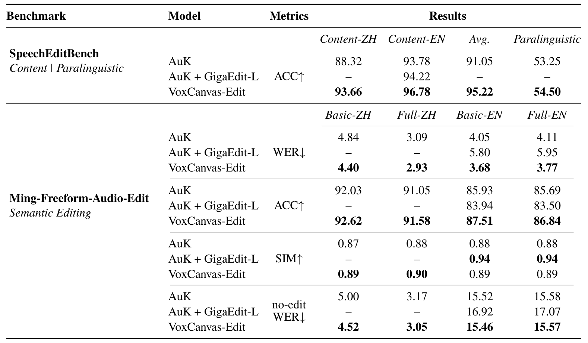

最直接的变化来自 SpeechEditBench：

- 中文内容编辑 ACC：**88.32% → 93.66%**，提升 5.34 个百分点。
- 英文内容编辑 ACC：**93.78% → 96.78%**，提升 3.00 个百分点。
- 双语内容平均 ACC：**91.05% → 95.22%**，提升 4.17 个百分点。
- 非语言声音编辑 ACC：**53.25% → 54.50%**，只提升 1.25 个百分点。

另一个评测 Ming-Freeform-Audio-Edit 的英文 Basic 设置中，WER 从 4.05% 降到 3.68%，ACC 从 85.93% 升到 87.51%；但 no-edit WER 只从 15.52% 降到 15.46%。

所以不能用一个“全面提升”就带过：**改对指定内容的收益较明显，未编辑文字保留与非语言编辑的改善小得多。** 声音身份相似，也不代表每个未修改词都保留了。

同样微调 AuK，VoxCanvas 的内容指标优于 GigaEdit-L，但数据规模、覆盖和构造方式同时改变，不能把差距单独归因于某一种过滤规则。GigaEdit-L 在 Ming 的英文 SIM 上反而更高，也说明不同指标存在取舍。

## 5. 比“数据越多越好”更重要的是：哪些任务一起学，按什么顺序学

前面的实验回答“数据有没有用”，这部分回答“能力怎么学出来”。两者不是同一套训练。

作者另外使用约 **2.78 亿可训练参数**的小型 AuK 骨干：4 个双流块、8 个单流块、隐藏维度 1024、16 个注意力头。多数实验使用英文数据，从头训练生成骨干 20 万步；冻结的预训练语义编码器并不是从零训练。

学习曲线主要看两个指标：**ES（Edit Success）检查要求的修改有没有完成；EM（Exact Match）要求归一化后的整句识别文字与目标完全一致。** 都越高越好，但 EM 更严格。把“周五”改对了，却漏掉其他词，ES 可能成功，EM 仍失败。

### 5.1 删除先学会，插入最慢；扩数据主要帮助新内容生成

下面按删除、插入、替换三行排列，左列 EM，右列 ES；蓝、橙、绿分别使用 5 万、50 万、500 万条数据。

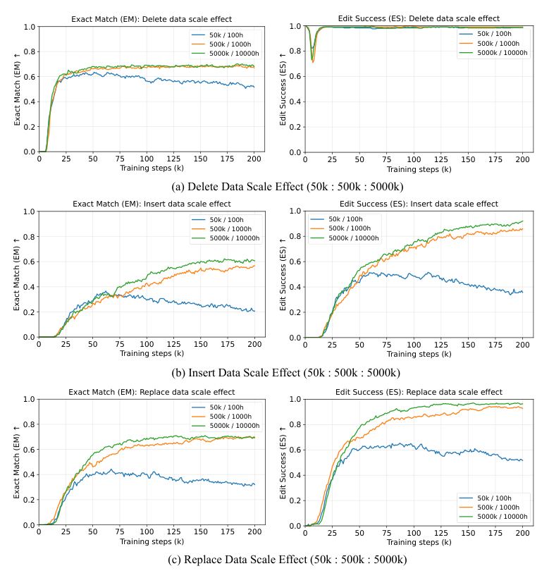

删除的 ES 很快接近饱和，数据规模影响较小，但 EM 没有因此接近满分。说明“删掉指定内容”和“整句其他内容都正确”确实不是一回事。

插入、替换从 5 万扩到 50 万条明显受益，继续扩到 500 万条的边际收益减小；小数据的后期退化也更明显。独立训练时，删除约在 5 万步内进入稳定阶段，替换其次，插入最慢。

这个顺序与任务要求相符：删除主要去掉已有内容并衔接上下文，插入和替换还得生成新的声音。不过这只是解释现象的直觉，论文没有证明它是唯一机制。

**不能给所有任务套一个数据量目标，也不能把本实验的边际收益递减解读成“50 万条普遍够用”。** 模型大小和训练预算变了，结论可能跟着变。

### 5.2 两个任务互相拖累，不代表三个一起更差

下图前两列分别是 EM 和 ES，四行依次比较“插入+删除”“插入+替换”“删除+替换”“三种一起”；实线是混训，虚线是单任务基线。

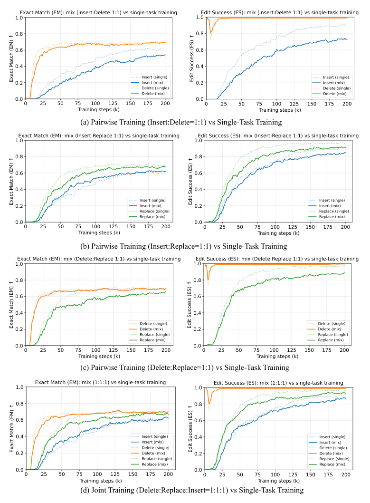

插入与删除混训时，插入明显变慢，删除基本不受影响；替换与删除混训，也会拖慢替换。但把替换加入“插入+删除”之后，插入的劣化大体消失，接近或优于单任务训练。

**任务交互不是两两关系的简单相加。** “删除会伤害插入”不能直接推出“三种一起训练更差”。

作者还比较插入、替换、删除的比例 `1:1:2`、`1:1:1`、`5:5:1`。在这三种配比里，均衡的 `1:1:1` 在收敛速度和最终效果间较合适；大幅增加生成型操作，只带来有限收益，还会影响删除表现与早期收敛。它是这组实验的较好折中，不是已被证明的全局最优配方。

### 5.3 先会生成，再学编辑；编辑监督也能反过来帮助生成

下面比较从零训练与 TTS 预训练初始化。蓝线很早就达到较高水平，尤其有利于插入和替换；从零训练最终能接近，但要走更长的路。

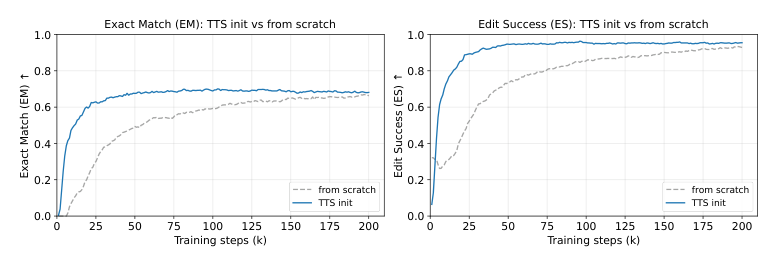

普通 TTS 先学“怎么生成自然声音”，编辑训练再学“在原录音约束下，什么该变、什么不该变”。这个迁移关系很合理，也确实在曲线上成立。

编辑与生成联合训练同样能加快编辑收敛，但编辑:生成达到 `1:10` 时反而削弱编辑表现。**生成先验有帮助，不等于生成数据越多越好。**

反方向也值得注意。作者把同一批编辑对改造成普通生成数据，作为控制组，检查收益是否仅仅来自“多了一些声音”。下面左列按相同训练步数比较，右列按模型累计见过的生成任务音频小时数比较；三行分别是 WER、SIM 和 UTMOS。

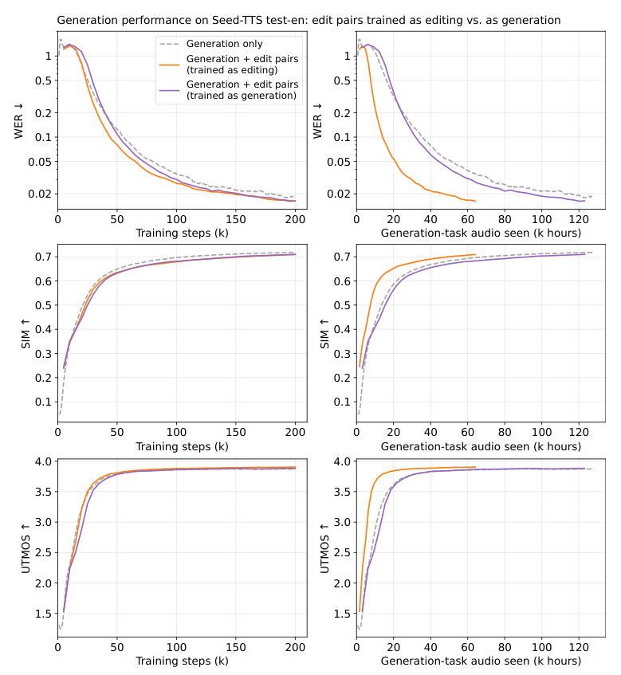

显式编辑与生成联合训练，比把同样的编辑对仅当作额外生成数据更快收敛。收益不只是数据多样性，还来自“理解源录音、执行变化、保留其他内容”的监督约束。

但右列控制的是生成任务的数据曝光量，**并没有控制总计算成本**：联合模型还训练了编辑任务。这里证明的是更好的学习效率，不能直接换算成同等 GPU 时间下的加速倍数。

### 5.4 多位置编辑先练基本功，笑声编辑则要警惕评测盲点

对多位置编辑，作者比较三种方法：从零只学多位置、从零混合单位置与多位置、先学单位置再转多位置。下面橙线是由简单到复杂的 curriculum learning，即课程学习。

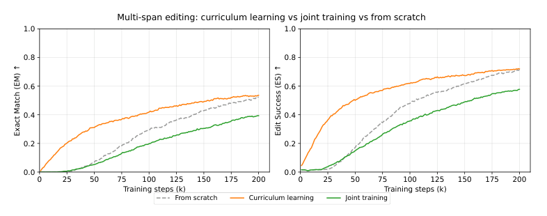

先单后多明显加快收敛，整体效果最好；从头把两种任务按 `1:1` 混在一起，反而收敛更慢。**复杂指令的组合能力，更适合建立在已学会的基本操作上，不一定靠混合数据自动长出来。**

评测共 1000 条，2—6 次操作各 200 条。操作越多，整条成功率越低。论文还统计 subES，即每条指令成功完成的子操作比例，方便区分“完全没做”与“做对四个、漏了一个”。

最后是非语言声音。作者在中文上选取呼吸、笑声、叹气、咳嗽四类，用 100 条配对录音控制编辑位置。普通 ASR 不可靠地识别这些发声，因此用 Qwen3-Omni-Instruct 直接听声音，判断指定词或事件有没有出现。

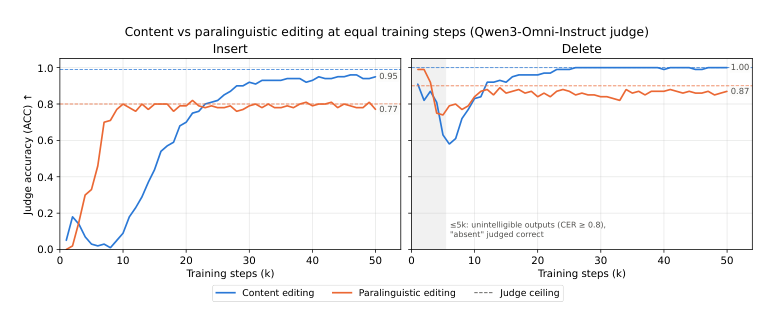

左图显示，非语言插入在语音开始可懂之后较早改善；内容插入则较长时间只复述原录音。右图中，两种删除在输出可懂之后轨迹更接近。

虚线是判分模型在标准目标音频上的准确率，它对非语言事件本身也会误判；右图很早的高分甚至可能来自“输出听不懂，所以目标被判为不存在”。因此，**不能把早期删除高分直接当成已经学会编辑，也不能把四类声音、100 条样本的结论扩大到所有非语言事件。**

## 6. 总结：先把监督造对，再讨论数据规模

VoxCanvas 最值得记住的不是“4100 万”这个数字，而是三层设计：

- **数据层：**通过转写、对齐、局部合成和过滤，把普通录音变成可训练的编辑对。
- **监督层：**把合成音频放在输入端、真实录音放在目标端，减轻向合成伪影学习的问题。
- **训练层：**区分基本操作的难度，控制任务配比，利用生成预训练，再由单位置走向多位置。

这些实验支持一个实用起点：**先建立声音生成能力，均衡学习插入、删除、替换，再学习复杂组合。** 但论文没有把这几条结论合成一套统一方案，并证明它在所有模型与总计算预算下都最优。

还有三条边界：大部分学习规律来自小型骨干；模板指令与自动过滤会限制数据分布；非语言、情绪风格和历史相关多轮请求不能混为同一种能力。当前公开仓库提供的是数据构建管线，也不能直接等同于 VoxCanvas-Edit 的完整训练发布。

**对于编辑任务，“目标够不够真实、变化够不够可控、训练组织是否合理”，往往比单纯再加一批样本更值得先检查。**

## 补充图表：完整原图与实验细节

下面保留正文未展开的完整图表，按问题归类，便于对照原文。正文的核心结论不依赖读完这些补充内容。

数据覆盖与转写：任务样例、替换长度、转写对照

原始任务表列出中英文指令与各类规模；替换长度图说明替换不只是等长换词，纵轴是新片段长度、横轴是原片段长度。

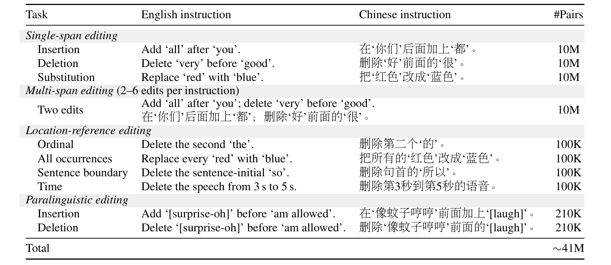

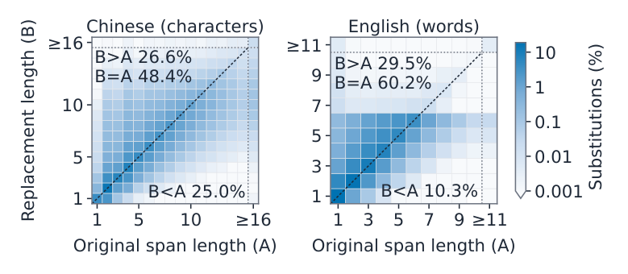

转写对照中，WER 下降，但 SIM、UTMOS 没有同步上涨。两种模型使用相同 Emilia 音频训练，区别是转写文本。

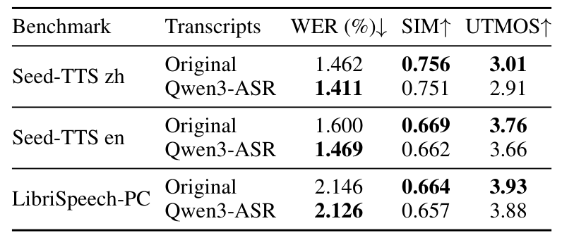

训练设置与基本操作：模型配置、单任务曲线、中英文对照

配置表明确区分原 AuK 与用于学习规律分析的小型骨干，不能将右侧训练设置套到最终 LoRA 微调。

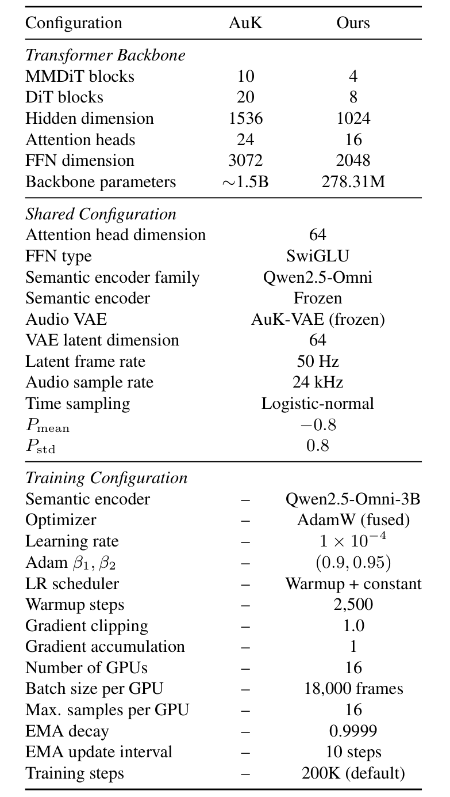

单任务曲线再次展示删除、替换、插入的收敛差异。中英文细分图的 CER 是字错误率，将 WER 的比较单位从词改成字，同样越低越好。

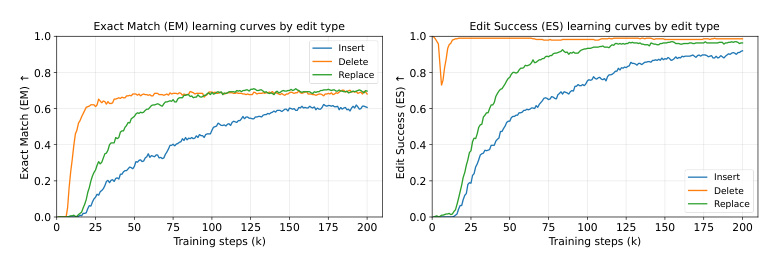

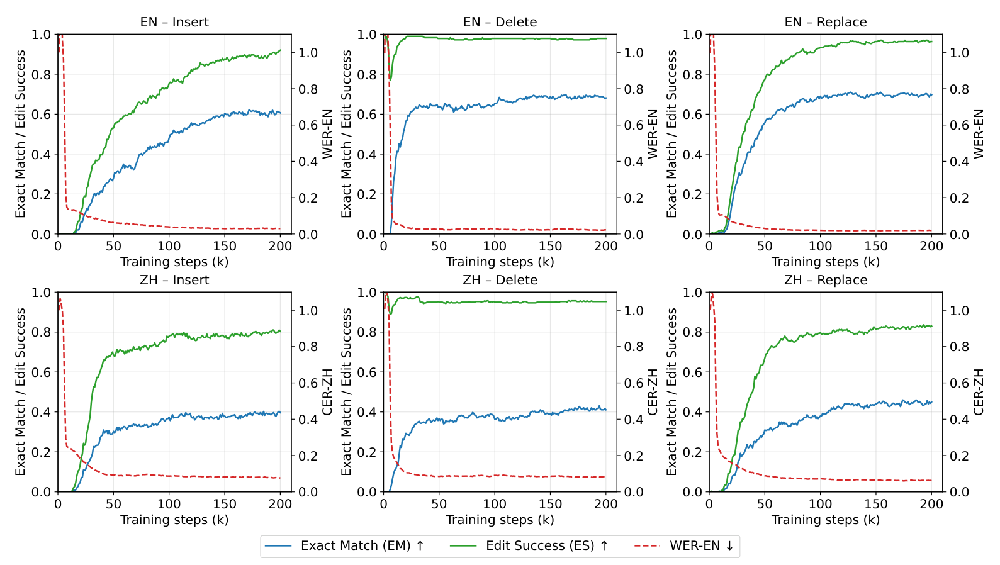

训练组织：任务配比、生成混训与初始化、组合复杂度

配比图比较 `1:1:2`、`1:1:1`、`5:5:1` 三种插入:替换:删除比例，细分图可检查整体分数掩盖了哪些任务取舍。

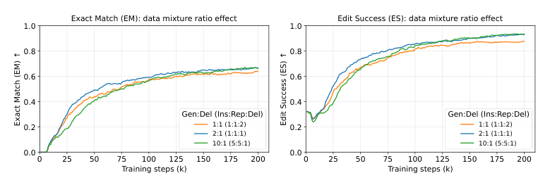

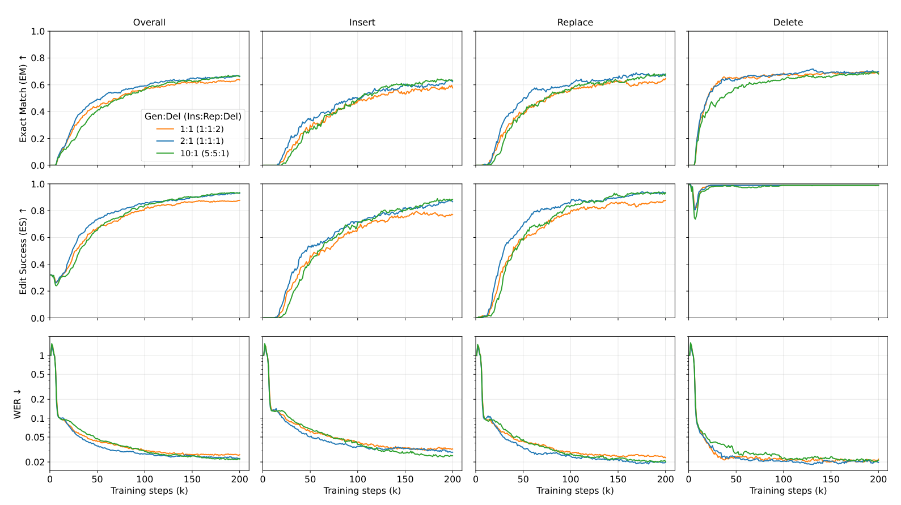

生成混训图比较编辑:生成的 `1:1` 和 `1:10`；初始化细分图则表明收益主要体现在更早学会插入和替换。

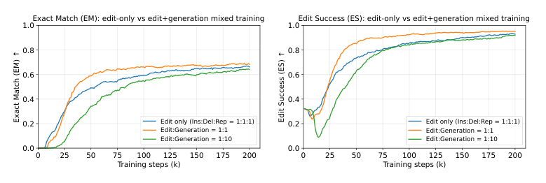

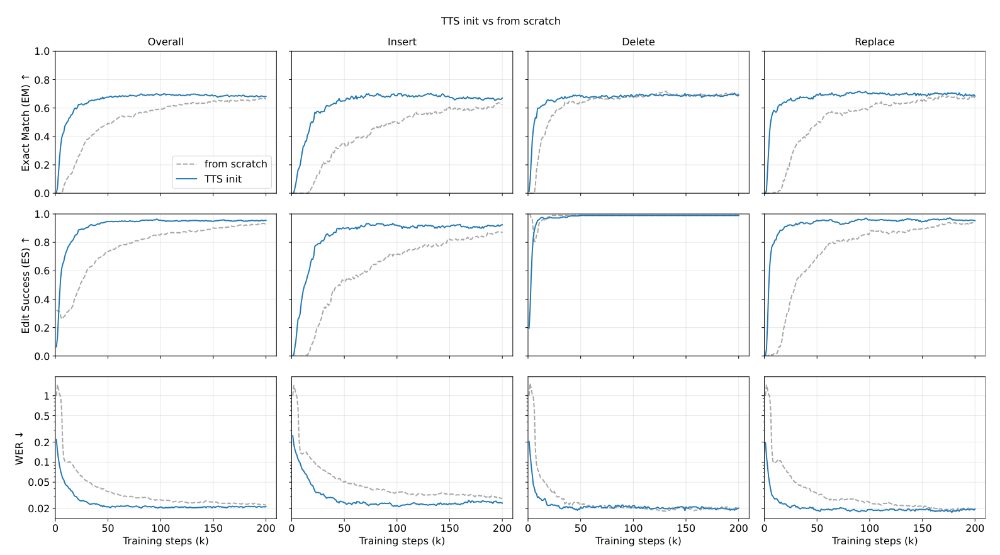

组合复杂度图按 2—6 次编辑分别报告结果，下面一行是 WER。操作数量增加时，全指令成功率下降，课程学习的早期优势仍可观察到。

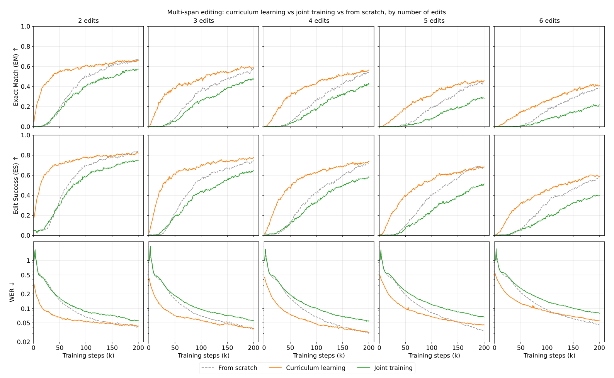

---

顺带一提，《动手学 AutoML：从 NAS 到大语言模型优化实战》整理了架构搜索、模型压缩、模型融合与后训练剪枝的相关方法。它不覆盖本文的语音编辑数据管线；如果想把阅读方向从“训练数据怎么组织”拓展到“模型结构与成本怎么优化”，可以作为另一条线来看。

> 
