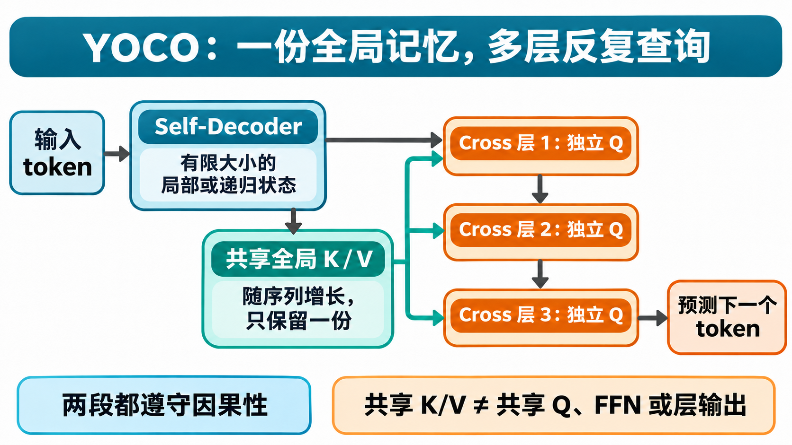
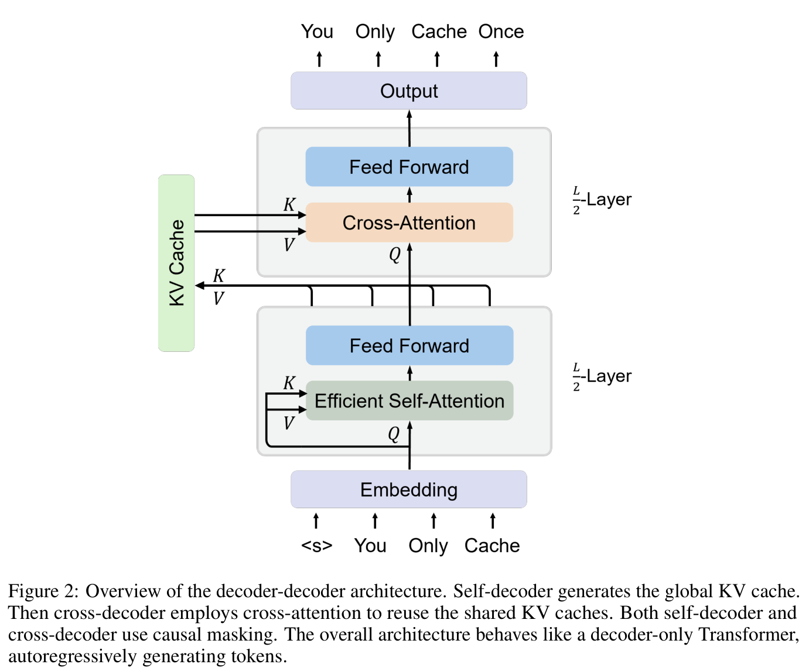
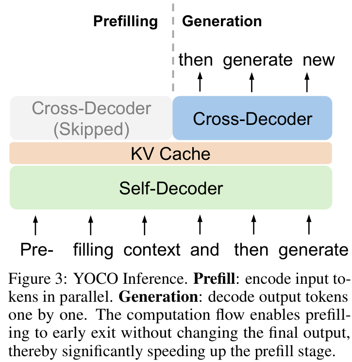
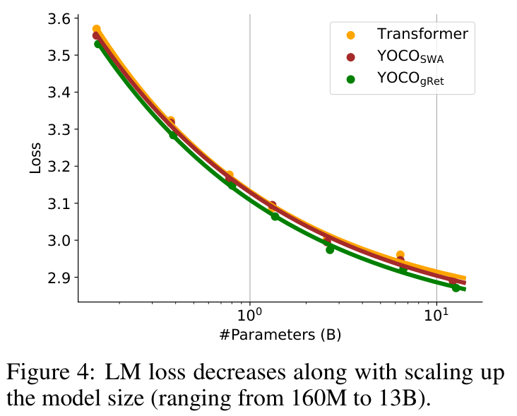
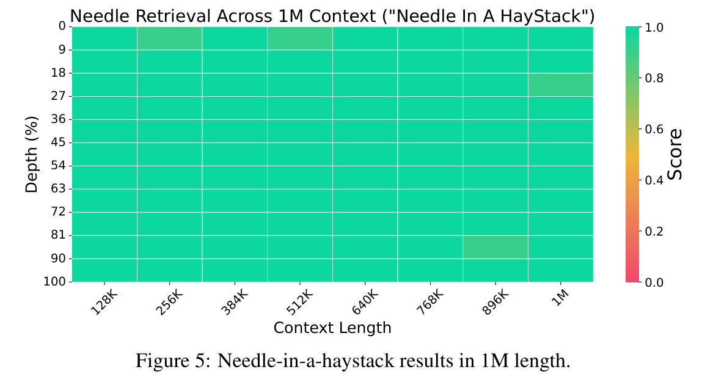
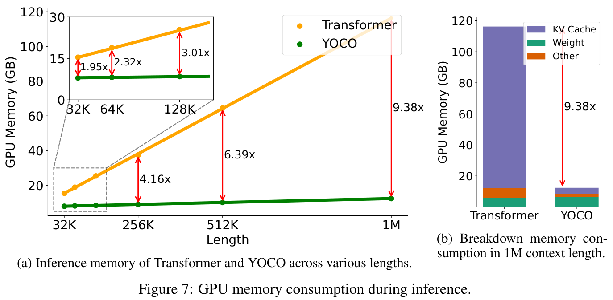
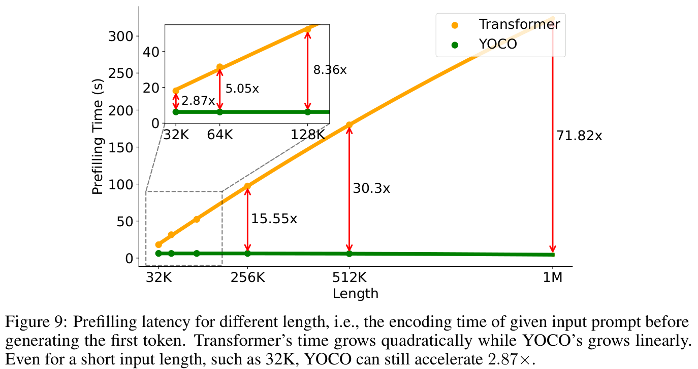
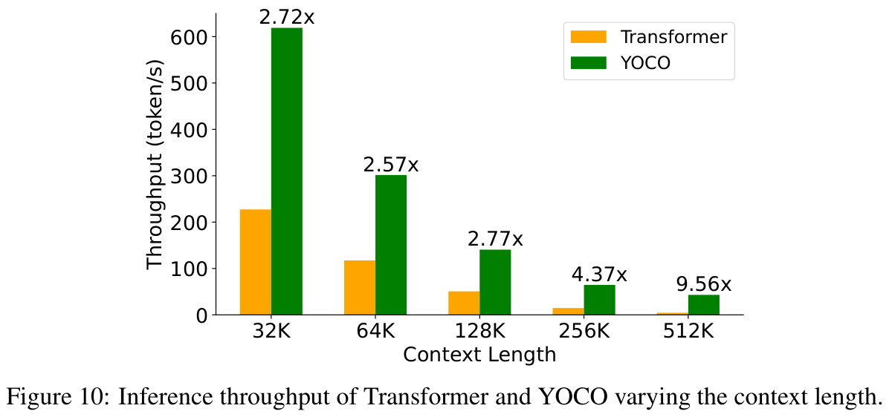

# NeurIPS'24 | YOCO：长上下文 LLM 为什么不必每层都存一份 KV Cache？

> 原文：[You Only Cache Once: Decoder-Decoder Architectures for Language Models](https://arxiv.org/html/2405.05254v2)
>
> 官方代码：[microsoft/unilm/YOCO](https://github.com/microsoft/unilm/tree/master/YOCO)。原文实验对应 arXiv v2，后续工作检索截至 2026 年 11 月 12 日。

---

## 1. 模型权重放得下，长文档却未必读得动

给一个 3B 模型塞进几十万 token 的文档，直觉上会觉得：模型才几十亿参数，十几 GB 显存总该够了吧？

但部署时经常是另一回事。权重只占一部分，文档越长，推理时保留的历史信息越多；即使显存够，模型读完输入、吐出第一个字之前，也可能让你等很久。

这里有两笔不同的账。

一笔是**存储账**：模型生成后文时要反复访问前文，通常会把前文各层 attention 用到的 key、value 保存下来，这就是 KV cache。文档变长，缓存跟着长；层数变多，还要再乘一次层数。

另一笔是**计算账**：开始生成之前，模型先处理完整输入，这个阶段叫 prefill。普通全局 attention 要计算大量位置之间的关系，长文档上的开销很容易压过后面生成几百个 token 的时间。

量化、分页管理、优化 attention kernel，都能缓解这些问题。但只要模型架构不变，有个前提就一直没动：**每一层都自己构造、自己保存一份历史 KV。**

YOCO 把这个前提拿出来改了。

它没有取消网络深度，而是把“把历史整理成可查询的记忆”和“拿着当前问题反复查询记忆”分开。记忆只构造一份，后面的多层网络共用它。

更有意思的是，这个改变不只是省显存。计算依赖变了以后，prefill 中原本看起来必须做的一大块计算，竟然也可以不做。

今天重新读这篇 2024 年的论文，最值得关注的就是这两件事怎么连起来：**跨层共享 KV 为什么成立，以及它为什么顺带改变了长上下文的计算路径。**

## 2. KV 为什么会乘上层数？从一次查询说起

假设模型已经读到“张三把钥匙放进抽屉”，现在要续写后面的句子。

对 attention 来说，当前位置产生一个 query，表示“我现在需要找什么”；历史每个位置提供一个 key，供它判断相关性；匹配之后，从相应 value 中取出信息并加权汇总。

模型通常会用多个 head，在不同的投影空间里分别查询，再合并结果。单个 attention head 在位置 $t$ 上的计算可以写成：

$$
o_t=\operatorname{softmax}\left(\frac{q_tK_{\leq t}^{\mathsf T}}{\sqrt{d_h}}\right)V_{\leq t}.
$$

$d_h$ 是一个 head 的向量维度。$K_{\leq t}$、$V_{\leq t}$ 收集当前位置及之前的 key、value。只看过去、不看未来，就是这里的因果约束。

生成下一个 token 时，历史位置的 key、value 不会因为新 token 到来就改变。把它们缓存起来，就不用把整段历史重新算一遍。query 则由新的当前位置生成，不需要把所有旧 query 都留着。

这很好理解。麻烦在于，普通 Transformer **每层看到的表示不一样**。

第一层输入来自 embedding，第二层输入已经被第一层更新过，第三层又变了一次。因此不同层产生的 key、value 本来就是不同对象。不能因为形状相同，就把第十层的 KV 当成第二十层的 KV 用。

设 batch 大小为 $B$，历史长度为 $N$，共有 $L$ 层，每层有 $H_{\mathrm{kv}}$ 个 KV head，每个 head 维度为 $d_h$，每个元素占 $b$ 字节。常规缓存容量约为：

$$
M_{\mathrm{KV}}=2BNLH_{\mathrm{kv}}d_hb.
$$

前面的 2 是 K 和 V 各一份。层数 $L$，就是刚才那笔“每层都要保存”的账。

拿一个与 YOCO-3B 对齐的教学配置算一下：26 层，8 个 KV head，head dimension 为 128，K/V 都按每元素 2 字节存储，batch 为 1。

长度取 $N=131072$，也就是 128 Ki token：

$$
2\times131072\times26\times8\times128\times2
=13\ \mathrm{GiB}.
$$

**还没算权重和临时激活，光 KV 就要 13 GiB。**

这个配置已经用了 grouped-query attention，简称 GQA：多个 query head 共用较少的 KV head。它省掉的是 head 这个维度上的冗余，但每层仍然各有一份 KV。

所以还可以追问一步：head 之间能共享，层之间能不能共享？

能，但不能直接把训练好的各层缓存强行合并。YOCO 为此重新设计了网络的信息流。

## 3. 不让每层都整理历史，而是先整理一次，再反复查询

YOCO 将网络分成前后两段。原设计中，总共 $L$ 层，前后各占一半。

- **Self-decoder** 先处理输入序列，生成带上下文的 token 表示。
- **Cross-decoder** 在这些表示之上继续计算，但所有层都查询同一份全局 KV。

这里的 decoder-decoder 不是传统“编码器读原文、解码器写译文”的结构。两段都处理同一条自回归序列，都不能偷看未来；只是前后两段 attention 的信息来源不同。

下面这张图从左往右读主干，再看中间记忆到右侧各层的分支。深色箭头是逐层更新的 hidden state，青色箭头是反复读取的共享记忆；右侧只画三层来说明串联关系，不代表实际层数。

输入先经过 self-decoder。它的输出一方面继续沿主干进入 cross-decoder，另一方面投影成共享 K/V。进入第一层 cross 后，当前位置用自己的 query 查这份 K/V；查完、更新表示，再进入第二层，产生新的 query，再查同一份 K/V。

**共享的是被查询的记忆，不是查询本身，也不是各层的计算结果。**

比如读一份项目材料，第一遍先找“谁负责”，第二遍基于找到的人再查“他负责的模块出了什么问题”，第三遍结合前两步组织回答。材料没换，查询却一步步变了。这个类比不是说某个 head 必然对应某种语义，而是说明：反复读同一份记忆，并不等于每次都得到同一个结果。

具体来说，设 self-decoder 最后的输出为 $M$，共享 KV 由统一的归一化和投影得到：

$$
\bar K=\operatorname{Norm}(M)W_K,\qquad
\bar V=\operatorname{Norm}(M)W_V.
$$

cross-decoder 第 $\ell$ 层则根据自己的输入 $X^{(\ell)}$ 计算：

$$
Q^{(\ell)}=\operatorname{Norm}_{\ell}(X^{(\ell)})W_Q^{(\ell)}.
$$

随后执行带因果约束的 attention：

$$
U^{(\ell)}=X^{(\ell)}+
\operatorname{Attention}_{\ell}(Q^{(\ell)},\bar K,\bar V),
$$

$$
X^{(\ell+1)}=U^{(\ell)}+
\operatorname{FFN}_{\ell}(\operatorname{Norm}'_{\ell}(U^{(\ell)})).
$$

FFN 是逐位置的前馈网络：对每个位置的特征做非线性变换，本身不在不同历史位置之间传递信息。attention 里还包含各层自己的输出投影；上面的写法将它收进了 $\operatorname{Attention}_{\ell}$。

因此后半段仍然有独立的 query 投影、输出投影、归一化、FFN 和残差连接。网络深度没有被压成“一次查表”。

对照论文原图，可以从底部往上看：embedding 进入前半段，前半段输出分出 K/V 到左侧缓存，主干继续向上，后半段从左侧取回同一份 K/V。

图里下半段自己也有序列交互，上半段则将 query 和记忆来源分开。两部分之间的这条分界，既决定了缓存怎么存，也决定了哪些历史计算可以跳过。

不过还有个问题没解决：**如果前半段仍然每层保存完整全局 KV，只是后半段共享，最多不就是省掉半数缓存？**

YOCO 真正省下层数倍缓存的前提，就藏在 self-decoder 的选择里。

## 4. 前半段用有限状态，为什么还能保留长距离信息？

YOCO 对 self-decoder 有一个关键要求：每层推理时保留的状态，不能随着输入长度无限增长。

论文给出两种选择。一种比较直观：**sliding-window attention，滑动窗口 attention**。每层只保留最近固定窗口里的 KV，例如 1024 个位置。输入再长，单层这部分缓存也不继续长大。

窗口外的信息不能被该层直接查询，但这不意味着整个模型只能看到最近 1024 个 token。因为 self-decoder 每个历史位置的最终输出，仍会被写入那一份全局 KV，后半段可以对所有历史位置做 attention。

另一种选择是论文默认采用的 **gated retention，带门控的递归记忆机制**。它不逐个保存所有历史 key、value，而是将历史累积进一个固定形状的矩阵状态。

忽略多头组合、位置处理和输出门控，单个 head 的核心递推是：

$$
S_t=\gamma_tS_{t-1}+k_t^{\mathsf T}v_t,
\qquad o_t=q_tS_t.
$$

这里将 $q_t$、$k_t$、$v_t$ 看作行向量。$k_t^{\mathsf T}v_t$ 是一个外积，将当前位置的信息写进矩阵；$\gamma_t$ 是根据当前输入生成的衰减门，控制旧状态保留多少。原方法的衰减是 head-wise 的，同一个 head 的状态使用同一衰减系数。

用一个刻意缩小的例子看就很直接。如果 key、value 都是 2 维，每个位置写入一张 $2\times2$ 的矩阵。读完 10 个 token，状态是 $2\times2$；读完十万个，仍然是 $2\times2$，不是十万行的历史列表。

把递推展开，就能看出它没有凭空丢掉全部远处信息：

$$
S_t=\sum_{i=1}^{t}\left(\prod_{j=i+1}^{t}\gamma_j\right)k_i^{\mathsf T}v_i,
$$

$$
o_t=\sum_{i=1}^{t}\left(\prod_{j=i+1}^{t}\gamma_j\right)(q_tk_i^{\mathsf T})v_i.
$$

历史写入都可以影响当前位置，只是经过了随输入变化的衰减。它与标准 softmax attention 并不相同：这里没有对每个历史位置做 softmax 归一化，也没有将所有历史条目原样保存在递归状态里。

例如旧状态是 $S_{t-1}=\left[\begin{smallmatrix}2&0\\0&2\end{smallmatrix}\right]$，当前门值 $\gamma_t=0.5$，新写入的 key、value 分别为 $k_t=[1,0]$、$v_t=[3,4]$，那么：

$$
S_t=0.5\begin{bmatrix}2&0\\0&2\end{bmatrix}
+\begin{bmatrix}3&4\\0&0\end{bmatrix}
=\begin{bmatrix}4&4\\0&1\end{bmatrix}.
$$

如果当前 query 为 $q_t=[1,0]$，读出的就是 $o_t=[4,4]$：旧信息衰减后，与新写入信息混在同一个状态里。固定状态当然有代价，不同历史信息会混合、竞争，不能指望一张有限矩阵无损装下任意长序列。

**YOCO 没有要求这张矩阵独自承担全部精确检索。** 前半段用它构造上下文化表示，后半段仍然可以读取每个历史位置对应的全局 KV。有限递归状态和逐 token 的外部记忆，是同时存在的。

因此，“You Only Cache Once”准确的意思是：**随序列长度增长的全局 KV 只保留一份；不是模型只剩一个状态，更不是所有历史都被塞进一个固定向量。**

## 5. 递归会不会让 GPU 只能一个 token 一个 token 地算？

刚才那条递推很省缓存，但如果训练和 prefill 也严格按 $S_1,S_2,\ldots,S_N$ 串行执行，GPU 的并行能力就浪费了。

gated retention 的另一个重要性质是：同一套计算可以写成三种等价形式。

| 形式 | 怎么算 | 更适合什么阶段 |
|---|---|---|
| 并行形式 | 展开位置之间的加权关系，批量计算 | 利用序列内并行 |
| 单步递归 | 维护一个状态，每来一个 token 更新一次 | 自回归 decode |
| 分块递归 | 块内并行，块间传递汇总状态 | 长序列训练和 prefill |

分块时，例如每块 256 个 token：先处理第一块，产生块末状态；第二块一边并行计算自己块内的交互，一边读取上一块传来的状态。

**256 是计算调度的块大小，不是“模型只能记住最近 256 个 token”。** 更早的历史通过块间状态继续传递。

原文推理实验使用的就是这种组合：prefill 走 chunkwise recurrent，decode 走单步 recurrent。两种形式对应同一数学运算，只是在浮点实现中仍可能有数值误差差异。

这也解释了为什么 YOCO 不是简单地“前半段换一个省内存模块”。所选模块还得能高效批量处理输入，否则只是把显存问题换成了串行等待问题。

## 6. 真正巧的地方：历史位置为什么不必经过后半段？

缓存少了，prefill 为什么还会快这么多？

只把“后半段共用 KV”理解成存储优化，很容易漏掉这里最重要的计算依赖。

普通 Transformer 中，后面的新位置在第 $\ell$ 层，需要查询历史位置在这一层对应的 KV。而这些 KV 又依赖历史位置经过前面各层的表示。要把供未来使用的各层缓存准备好，prompt 历史位置就得逐层算上去。

YOCO 不同。未来位置在任意一个 cross 层里查询的，都已经是 **self-decoder 输出产生的那份全局 KV**。它不需要历史位置在上一 cross 层算出了什么。

举个具体例子。prompt 有 10000 个 token，现在要预测第 10001 个。

1. 前 10000 个位置都要经过 self-decoder，才能建立有限状态和共享 KV。
2. 第 10000 个位置的表示进入第一层 cross，查询前 10000 个位置的共享 KV。
3. 这个位置更新后的表示进入第二层 cross，还是查询相同的共享 KV。
4. 逐层走完后，预测第 10001 个 token。

这个过程中，**第 10000 个位置并不依赖“第 9999 个位置经过第三层 cross 后的输出”**。它需要的历史信息已经从共享 KV 这条旁路送来了。

所以，第 1 到第 9999 个位置的 cross-decoder 输出，即使全部不算，也不会缺少后续生成需要的缓存。

下面这张原图按左、右两部分读。左侧灰色块表示 prefill 历史位置可以跳过 cross-decoder；右侧蓝色块表示生成阶段当前位置仍然要经过它。

底部 self-decoder 始终工作，中间 KV cache 也始终存在。跳过的是左上角那些不会再被使用的历史 cross 输出，不是跳过输入编码，更不是跳过全部 attention。

这里最容易误读的一句话是“prefill 不运行 cross-decoder”。准确地说：**无需为整个 prompt 的每一个历史位置运行 cross-decoder；但最后一个 prompt token 仍要经过 cross-decoder，用这个位置的输出预测第一个新 token。** 第一个新 token 此时还没有被采样出来，不是它已经作为输入走完了网络。

官方 needle 测试代码处理得很清楚：先将 prompt 除最后一个 token 外的部分分块送入模型，打开 `skip_cross_decoder=True`，构建 self state 和全局 KV。然后保留最后一个 prompt token，交给完整模型处理，用它的最终输出预测第一个新 token。

这不是传统意义上的“算到一半觉得置信度够了，于是提前退出”。它没有用近似答案替代完整答案，而是**根据依赖关系，删除了未来不会消费的中间结果**。这里的不改变输出，是相对于同一个 YOCO 模型的完整计算路径，不是说它与原先的 Transformer 完全等价。

从长序列复杂度看，普通全局 attention 的 prefill 有平方项。YOCO 的 self-decoder 用固定窗口或固定大小的分块递归，历史 cross 计算又可以省掉；剩下最后位置的 cross 查询对历史长度是线性的。因此在固定模型和块大小下，prefill 随输入长度可以做到线性增长。

这不是说所有计算都没了。投影、FFN、归一化、状态更新、KV 写入照样要做；最后位置也照样要扫描历史。**消失的是让整段历史在后半段反复做全局两两交互的必要性。**

## 7. 落到 3B 源码，究竟存了哪些张量？

上面是设计逻辑。看官方实现，能把“只缓存一次”的边界钉得更实。

本文核对的源码固定在 UniLM 提交 `7402b0eefe7eee5863c7b2c164a7b13cdc6425e6`。YOCO-3B 共 26 层，前后各 13 层；hidden dimension 为 3072，FFN 中间维度为 8192。

设 batch 为 $B$，本次输入长度为 $S$，cross 阶段本次处理的 query 长度为 $T$，数据流如下：

| 位置 | 实际形状或配置 | 含义 |
|---|---|---|
| token embedding | `[B, S, 3072]` | 输入主干 |
| 13 层 self 输出 | `[B, S, 3072]` | 生成共享记忆的源表示 |
| 共享 K、V 投影 | 各 `[B, S, 1024]` | $1024=8\times128$ |
| reshape 后 K、V | 各 `[B, S, 8, 128]` | 8 个 KV head，每个 128 维 |
| 每个 cross 层的 Q | `[B, T, 24, 128]` | 24 个 query head，各层独立生成 |
| 每个 self 层的递归矩阵状态 | `[B, 24, 128, 128]` | 24 个 retention head，不随历史长度增长 |

注意最后两行不是同一种 head 配置。**不能把 self 的 24 头矩阵状态，误写成 cross 的 8 头普通 KV cache。**

共享投影在 `CrossDecoder.forward` 中集中完成，K 做旋转位置编码 RoPE，让 attention 能利用相对位置信息；各 cross 层对自己的 Q 也做相应位置处理。V 不做这一步。

随后，每层 `CrossAttention.forward` 只投影自己的 Q，再调用带 `causal=True` 的 attention 读取传入的 K/V，没有逐层重新生成 K/V。

另一个值得看调用顺序的地方是：`skip_cross_decoder` 的返回分支在共享 K/V 构造、写入缓存**之后**。所以打开跳过开关，并不会漏掉建立记忆这件事。

这套实现直接带来两个结论。

**第一，省下的是全局 KV 的层数因子，不是所有缓存都归零。**

沿用前面的 128 Ki token、2 字节缓存教学配置，一份全局 K/V 是 0.5 GiB。13 个 self 层的递归矩阵状态如果也按 2 字节计，约为 9.75 MiB；实际实现还需看状态精度与其他缓存。它们不随历史长度增长，但依然要占空间。

因此，26 层普通 Transformer 对应的全局 KV 项从 13 GiB 降到约 0.5 GiB，很可观；却不能把它直接写成“整个推理显存减少 26 倍”，权重和工作空间还在那里。

**第二，存一份不等于只读一遍。**

13 个 cross 层各有不同 query，仍然会各自读取共享 K/V、计算 attention。共享存储并不会自动把这些查询合并成一次计算，也不保证同一份数据永远驻留在 GPU 片上缓存里。

这对推理系统很重要：容量、显存带宽、attention FLOPs 是三笔账。YOCO 同时改变了其中几项，但不是用一个“共享”就把三项全部消掉。

## 8. 架构改成这样，模型能力有没有被换掉？

这不是一个能给现成 Transformer 打上的无损运行时补丁。各层读的信息来源变了，模型需要围绕这个结构训练，才能学会怎样构造记忆、怎样查询记忆。

原文从两组训练实验验证这件事。

一组是模型规模实验，从 160M 到 13B，在统一数据和设置下比较语言建模 loss，也就是预测真实下一个 token 的损失，越低越好。下面的图横轴看模型规模，纵轴看 loss，重点是不同架构的曲线是否随着规模增大保持接近。

gated retention 版本整体有竞争力，说明“前半段递归建模、后半段共享全局记忆”并没有在这些规模上明显破坏扩展趋势。滑动窗口版本也说明，这套两段式结构不是与某一个 retention kernel 绑死的。

但这些 scaling 实验每个模型训练 10B token。它们回答的是**统一预算下的扩展趋势**，不是“13B 模型已经经过充分预训练，证明在所有任务上等价于成熟 Transformer”。

另一组是主力 3B 模型。非 embedding 参数约 2.8B，训练长度 4096，batch 为 4M token；学习率日程按 5T token 设置，但实际受资源预算限制训练到了 **1.6T token**。

在 1T token checkpoint 上，八个常识、阅读理解和科学问答等零样本选择题任务的平均得分为 0.634，论文列出的 OpenLLaMA-3B-v2 为 0.619，StableLM-base-alpha-3B-v2 为 0.612。这里的分数越高越好，且不同任务有各自的 Harness 评分口径。

这些结果支持“改架构之后仍然能训出有竞争力的模型”，不适合解读成 YOCO 对所有同规模模型的严格胜出。不同模型的数据、tokenizer 和训练配方并没有全部锁死一致。

长上下文也不是把位置上限从 4096 改成一百万就结束了。作者继续训练，按 64K、256K、1M 逐步扩展长度，并调整 RoPE 等设置。

下面这张单针检索热力图，横轴是上下文长度，纵轴是目标信息插入文档的深度。颜色表示模型能否找回预先插进去的目标，接近满分说明它没有简单地漏掉某个长度或位置区间。

图中大面积高分很有说服力：即使前半段没有逐层完整全局 KV，后半段依然能通过共享记忆定位远处信息。

不过“找回一条信息”和“同时找回、整合多条信息”不是一回事。论文另做了 **128K 长度**的多针检索，YOCO 的准确率是：

| 需要找回的信息条数 | 1 | 2 | 4 | 8 |
|---|---:|---:|---:|---:|
| 准确率 | 0.98 | 0.98 | 0.84 | 0.56 |

从 4 条到 8 条，下降已经明显。**百万 token 单针接近满分，不等于百万 token 的复杂推理和多证据整合已经解决。**

## 9. 省显存、省等待，论文数字分别说明了什么？

原文推理实验在 H100-80GB 上进行，对照 Transformer 也使用 GQA、Flash-Decoding 和 kernel fusion，并不是拿完全朴素的 attention 实现来当靶子。

实验序列的最后 1024 个 token 设为生成部分，其余是输入上下文。理解这个设置，才能区分 prefill 延迟和包含生成在内的吞吐。

先看显存图。左边随长度增长，右边拆分百万长度时的权重、激活和 KV；重点看随长度增长最快的部分来自哪里。

Transformer 的 KV 部分很快变成主要负担，YOCO 则主要保留一份全局 KV。论文报告，1M 长度时 YOCO **总体推理显存为 12.4 GB**，对照 Transformer 约为它的 9.4 倍。

这个 9.4 倍是整套推理显存结果，不是纯 KV 理论比值；也不要与前面按 GiB 计算的教学例子混用。

再看 prefill 延迟图。横轴是长度，纵轴是输入处理时间，两条曲线的增长方式比某个单点倍率更值得注意。

在论文的 H100-80GB 对照实验中，512K 输入的 Transformer prefill 约 **180 秒，YOCO 不足 6 秒**；32K 上测得 **2.87 倍**加速。长输入下差距越拉越大，来自平方项和线性路径的差别，而不只是少运行一半层。

最后看吞吐图，纵轴表示单位时间处理的 token 数，越高越好。这项统计包含 prefill 和生成时间。

512K 设置中，Transformer 为 4.5 token/s，YOCO 为 43.1 token/s，约 **9.6 倍**。论文把收益归因于更短 prefill，以及更低显存占用允许更大的推理 batch。

所以，不能把这句话缩写成“YOCO 单请求纯 decode 快 9.6 倍”。一旦换成短 prompt、长输出、不同 batch，瓶颈占比就会变；当 prefill 不再占大头，多层 cross 查询的带宽与计算仍然要付账。

## 10. 后来的工作，哪些真正接上了 YOCO？

YOCO 很容易被放进一个过于顺滑的故事：先有 YOCO，后来所有跨层 KV 共享都沿着它发展。

实际没这么简单。2024 年 5 月，压缩 KV 的几条路线几乎同时出现：DeepSeek-V2 在 5 月 7 日发布，YOCO 在 5 月 8 日首次提交，LCKV 在 5 月 17 日，CLA 在 5 月 21 日。时间接近，解决的问题也接近，但这不自动构成传承关系。

### 10.1 CLA、LCKV：同一个层数因子，可以有不同拆法

[CLA，Cross-Layer Attention](https://arxiv.org/abs/2405.12981)，让相邻 Transformer 层共享 key/value head。它不像 YOCO 那样明确划出“前半段建记忆、后半段读记忆”，而是把普通层分组，在组内复用 KV。

例如 24 层，每两层一组，就有 12 组 KV。这样可以在 GQA 之外再省缓存，但“共享组”的划分不同，表达能力与缓存大小的取舍也不同。

[LCKV](https://arxiv.org/abs/2405.10637) 则更激进地研究只计算、缓存少数层的 KV，让更多层的 query 使用这些 KV。特别是读取更上层的 KV 时，训练和 prefill 的依赖会更复杂，不能想当然套用 YOCO 的提前退出路径。

后来的 [A Systematic Study of Cross-Layer KV Sharing](https://arxiv.org/abs/2410.14442) 将“谁提供 KV、谁去查询、多少层共享”整理成统一配置空间。[官方 LCKV 实现](https://github.com/whyNLP/LCKV) 也能表达 CLA、YOCO 等不同配置。

这里更准确的关系是：**独立同期方案，后来被放进统一框架比较。** 不是 CLA、LCKV 都是 YOCO 的后续版本。

对于架构设计，这组工作留下的启发很实际：一份 KV 不是唯一答案。共享得越彻底，缓存越小；但所有深层 query 都得适应同一套记忆表示。按组共享多份记忆，可能换来更好的能力与训练稳定性。

### 10.2 DeepSeek MLA：压缩的是另一根轴

[DeepSeek-V2](https://arxiv.org/abs/2405.04434) 的 MLA，即 Multi-head Latent Attention，将每层需要缓存的 KV 信息压进较小的 latent 表示，并配合专门的位置处理和计算变换高效使用它。

它解决的是**单层每个 token 存多宽**；YOCO 重点解决的是**多少层分别存一份**。

因此 MLA 不是 YOCO 变体，也不是跨层共享的另一个名字。两者在设计空间上有组合的可能，但内存公式里两个因子能相乘，不代表真实 kernel 的效率也自动相乘。位置编码、恢复或投影开销、数据布局，都可能让纸面收益打折。

### 10.3 SambaY：明确沿着“建记忆—读记忆”继续走

与前面几条平行路线不同，2025 年的 [SambaY](https://arxiv.org/abs/2507.06607)，论文题为 *Decoder-Hybrid-Decoder Architecture for Efficient Reasoning with Long Generation*，明确讨论并比较了 YOCO。

它把前半段换成 Samba 式混合网络：将 Mamba 类状态空间模型与滑动窗口 attention 等模块结合。状态空间模型可以理解成用有限状态持续更新序列信息的一类机制，不需要每层保存全部历史 KV。

后半段则引入 GMU，Gated Memory Unit，读取并复用前半段的记忆读出状态。**继承的是“先构造可复用记忆，再由后续层读取”的结构思想；共享对象已经不再只是原始 YOCO 那份全局 K/V。**

这条变化有明确动机。原始 YOCO 即使缓存很省，生成一个新 token 时，多个 cross 层还是要对增长中的全局历史做查询。输出很长以后，读取历史的累计成本继续增加。SambaY 将共享记忆机制向混合、递归方向推进，关注的也正是长生成场景。

它不是给 YOCO 换一个 kernel 就获得的升级，而是需要重新训练的架构设计。但要找“YOCO 后来怎么发展”，这是比把所有 KV 压缩都挂到 YOCO 名下更直接的线索。

### 10.4 Gemma 3n：共享 KV 已经不只是论文里的原型

Gemma 3n 是一个很值得对照的实际模型。[Google 官方开发者指南](https://developers.googleblog.com/en/introducing-gemma-3n-developer-guide/) 明确介绍了 KV cache sharing：中间 local/global attention 层产生的 K/V，被顶部多层直接复用。

local attention 只查局部窗口，global attention 查询完整历史。Gemma 3n 不是让这两类层共用同一组 KV，而是后面的层分别复用此前同类型层的 KV。

[Transformers 实现](https://github.com/huggingface/transformers/blob/main/src/transformers/models/gemma3n/modeling_gemma3n.py) 也很直接：共享层仍计算自己的 query，但从 `shared_kv_states` 取 K/V，不再独立投影、写入自己的完整缓存。配置中的 `num_kv_shared_layers` 控制尾部多少层这样工作，具体数值要看 checkpoint。

这和 YOCO 的关键相似性，是**后面的层继续更新 query，但不再逐层重新构造历史记忆**。差别则在于，Gemma 3n 保留了 local/global 两类记忆来源，并不是原始 YOCO 那个“固定状态 self-decoder，加一份全局 KV”的完整结构。

也不要把它与 Gemma 3n 的 PLE caching 混为一谈。PLE 缓存的是逐层 embedding 相关参数或数据，KV sharing 复用的是 attention 的历史状态，两者可以同时存在。

官方资料足以确认它确实用了跨层 KV 复用；但仅凭机制相似，还不足以断言 Google 官方将其归因为 YOCO 的直接后续。更稳妥的说法是：**Gemma 3n 展示了 YOCO 风格的“记忆生产者—消费者”分工，已经能进入实际模型设计。**

### 10.5 xKV：不要求所有层用同一份 KV，而是共享表示它们的坐标系

2026 年 ICML 正式发表的 [xKV](https://proceedings.mlr.press/v306/chang26d.html)，提供了另一种值得借鉴的思路：不要求现成模型的不同层直接使用完全相同的 KV，而是利用它们之间可压缩的共同结构。

可以把低秩分解想成这样：多个层原本各存一大张表，现在找一组共同的基础方向，再用各层自己的较小系数表示原来的表。共享的是低维子空间，不是强行把各层的历史表示设成相同值。

因此 xKV 属于面向已有模型的训练后缓存压缩，不是 YOCO 的 decoder-decoder 改造。论文在相关工作中讨论 YOCO、CLA，但这表明它比较了已有路线，不等于直接采用了 YOCO 架构。

最终版本报告最高 8 倍 KV 压缩；再结合 Selective Reconstruction，也就是根据 query 选择性重建相关 token，在 A100、122K 上下文的特定实验中，报告最高 4.23 倍端到端生成吞吐提升。这是最终版本特定设置的上限，不能当成任意模型的保证。

这条路线的启发是：如果不能重新预训练，未必只能放弃跨层冗余。**架构上硬共享一份 KV，和训练后共享低秩表示，是两种不同的取舍。** 后者还要认真支付分解、重建和近似误差的成本。

将这几条路线放在同一张表里，关系就清楚了：

| 工作 | 主要共享或压缩什么 | 与 YOCO 的关系 |
|---|---|---|
| CLA / LCKV | 多层之间的 K/V | 独立同期路线，后续纳入统一研究 |
| DeepSeek MLA | 每层 KV 的 latent 表示 | 独立同期，压缩另一维度 |
| SambaY | 前半段产生的可复用记忆读出状态 | 明确讨论、比较并延伸 YOCO 结构思想 |
| Gemma 3n | 后部层复用此前 local/global 层的 K/V | 实际模型采用相似机制，不将相似性当作官方传承声明 |
| xKV | 分组层 KV 的共同低秩子空间 | 明确比较架构共享路线，自身是训练后压缩 |

## 11. 如果今天重新设计，哪些地方最值得继续改？

YOCO 留下的不是一个只能原样照抄的 13+13 配方，而是几个可以继续检验的问题。

### 11.1 一份记忆够不够，不应该只由缓存预算决定

将全部 cross 层绑定到一份 KV，相当于要求同一个记忆接口服务所有深度的 query。缓存小了，但早期特征、抽象关系、细节检索可能需要不同表示。

一个自然方向是分组记忆：例如先保留两份或四份不同深度的 KV，让不同 cross 组读取不同记忆。它会多占显存，却可能减少表示瓶颈。

这里不能只扫共享比例、看一次困惑度。困惑度反映模型对真实序列的预测不确定性，越低越好；但多证据检索、变量绑定、长代码依赖，可能比平均语言建模指标更早暴露共享接口的问题。

### 11.2 压缩全局记忆之后，不能把重建开销藏起来

一份全局 KV 仍然随序列长度增长。在它上面继续做低比特量化、低秩压缩、选择性读取，都有意义。

但如果每个 cross 层都要先恢复一大份高精度 K/V，再计算 attention，就可能把容量节省换成重复重建与临时张量开销。

更有价值的实现方向，是让压缩表示直接被高效读取，或让多个消费者复用必要的重建结果。要一起报告**持久缓存、临时峰值、额外计算、实际延迟**，不能只展示压缩比。

### 11.3 Prefill 省下来了，长输出就成了下一道题

一次读几十万 token、只回答几十字，原始 YOCO 的 prefill 路径非常有吸引力。

但如果输入很短、模型连续推理几万 token，历史 KV 会在生成过程中继续增长，cross 层也继续查询它。此时该问的不再是“输入能不能少算”，而是“哪些历史真的值得每层、每步都读”。

可以考虑递归记忆与精确检索混合、局部层与全局层分工、按查询选择记忆。代价则是：选错后能否恢复，跨很远的信息还能否找回，多轮对话中的旧事实会不会被覆盖。

SambaY 的价值也在这里：它提醒我们，原始 YOCO 对长 prefill 的优点，不应该被当作所有长生成负载的最终答案。

### 11.4 共享记忆，也需要推理框架理解“共享”

如果框架仍然按“每层拥有独立 KV”来分配页、维护元数据，模型层面已经共用的缓存，可能在系统里又被复制成多份。

分页 KV、prefix caching、并行切分都要认识这份记忆的所有权。prefix caching 是复用相同输入前缀的计算结果；对 YOCO 来说，复用前缀不仅要有共享 KV，还得保留能正确继续 self-decoder 的递归状态或窗口状态。

投机解码也一样。它先猜一段候选、再由目标模型验证，拒绝候选后要回滚。全局 KV 可以截断，递归状态却不能简单按 token 索引删几行，需要相应的状态快照或恢复机制。

这些不是模型论文多写一个“compatible”就自动解决的。**状态更少，不等于状态管理一定更简单。**

### 11.5 最后要优化的是请求成本，而不是单独一个压缩比

对一项真实服务，至少要把四组负载分开测：短输入短输出、长输入短输出、短输入长输出、长输入长输出。

每组再记录首 token 等待、逐 token 延迟、吞吐、峰值显存，以及检索和推理质量。共享组数、前后层数、状态大小、量化精度，都可以作为架构搜索变量，但目标应该是满足质量和延迟约束下的服务成本。

否则，很容易得到一个缓存压缩很漂亮、但用户实际等待并没有变短的“高效架构”。

## 12. 总结

YOCO 最值得记住的，不是“26 份缓存变成 1 份”这一个数字。

它先拆开了两个原本被同一层 attention 同时承担的职责：**历史怎么写成记忆，当前位置怎么读取记忆。** 前半段负责构造，后半段负责查询。查询可以有很多层，记忆却不必每层重做一份。

这个分工又进一步改变了依赖关系：后来的 token 不再需要历史位置的 cross-decoder 输出，prefill 就不必替历史位置把后半段全部算完。

因此，它是一次架构与推理计算图的联合设计，不只是缓存格式优化。

后续工作也可以据此分清楚：CLA、LCKV 研究跨层共享怎么安排；MLA 压缩每层缓存的表示宽度；SambaY 明确沿着共享记忆的两段式结构继续探索长生成；Gemma 3n 将类似分工用进实际模型；xKV 则在训练后寻找跨层共同的低秩表示。共同目标是降低历史信息的使用成本，手段却不相同。

真正值得带走的问题是：**下一步计算究竟会消费哪些历史结果？为了准备这些结果，哪些计算和存储才是必要的？**

把这个问题想清楚，往往比在既定架构里再挤掉一点开销，更可能找到新的优化空间。

## 参考资料

- [YOCO 原文 v2](https://arxiv.org/html/2405.05254v2)；[NeurIPS 2024 正式论文](https://proceedings.neurips.cc/paper_files/paper/2024/file/0df38cd13520747e1e64e5b123a78ef8-Paper-Conference.pdf)。
- [YOCO 官方源码，本文核验提交](https://github.com/microsoft/unilm/tree/7402b0eefe7eee5863c7b2c164a7b13cdc6425e6/YOCO)：重点为 `yoco/models/decoder/yoco.py`、`cross_attention.py`、`gate_retention.py` 及 `yoco/criterions/needle_haystack.py`。
- [Reducing Transformer Key-Value Cache Size with Cross-Layer Attention](https://arxiv.org/abs/2405.12981)。
- [Layer-Condensed KV Cache for Efficient Inference of Large Language Models（LCKV）](https://arxiv.org/abs/2405.10637)；[A Systematic Study of Cross-Layer KV Sharing](https://arxiv.org/abs/2410.14442)。
- [DeepSeek-V2](https://arxiv.org/abs/2405.04434)。
- [SambaY: Decoder-Hybrid-Decoder Architecture for Efficient Reasoning with Long Generation](https://arxiv.org/abs/2507.06607)；[Microsoft/ArchScale](https://github.com/microsoft/ArchScale)。
- [Google Gemma 3n 开发者指南](https://developers.googleblog.com/en/introducing-gemma-3n-developer-guide/)；[Transformers Gemma 3n 配置与实现文档](https://huggingface.co/docs/transformers/model_doc/gemma3n)。
- [xKV: Cross-Layer KV-Cache Compression via Aligned Singular Vector Extraction，ICML 2026](https://proceedings.mlr.press/v306/chang26d.html)。

---

顺带一提，YOCO 这种工作也很适合从架构搜索的角度看：哪些层负责写记忆，哪些层负责读，多少层共享一份，都是有实际部署代价的设计变量。《动手学 AutoML：从 NAS 到大语言模型优化实战》整理了架构搜索、LLM 压缩和相关实战；书里不讲 YOCO 的缓存实现，也不覆盖本文这些推理 kernel，但如果想把“架构可以怎么改”进一步变成可复现的搜索与优化问题，可以接着看这个相邻方向。

> 
