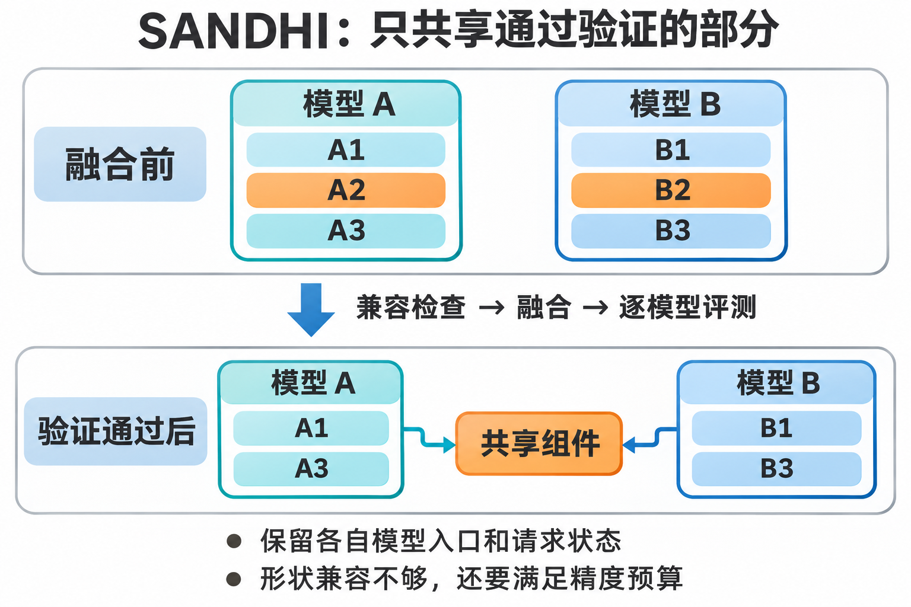
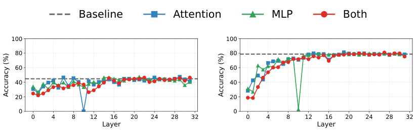
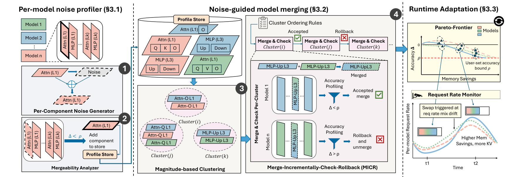
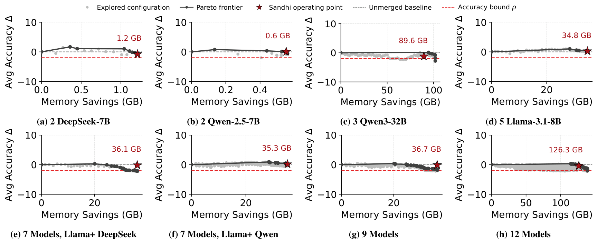
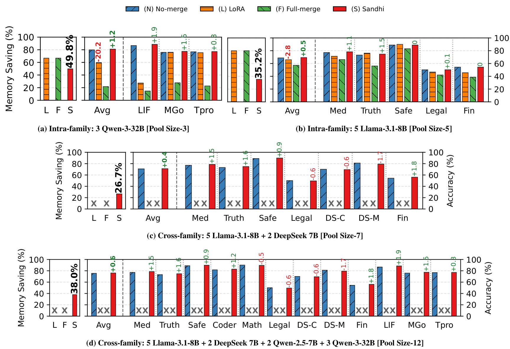
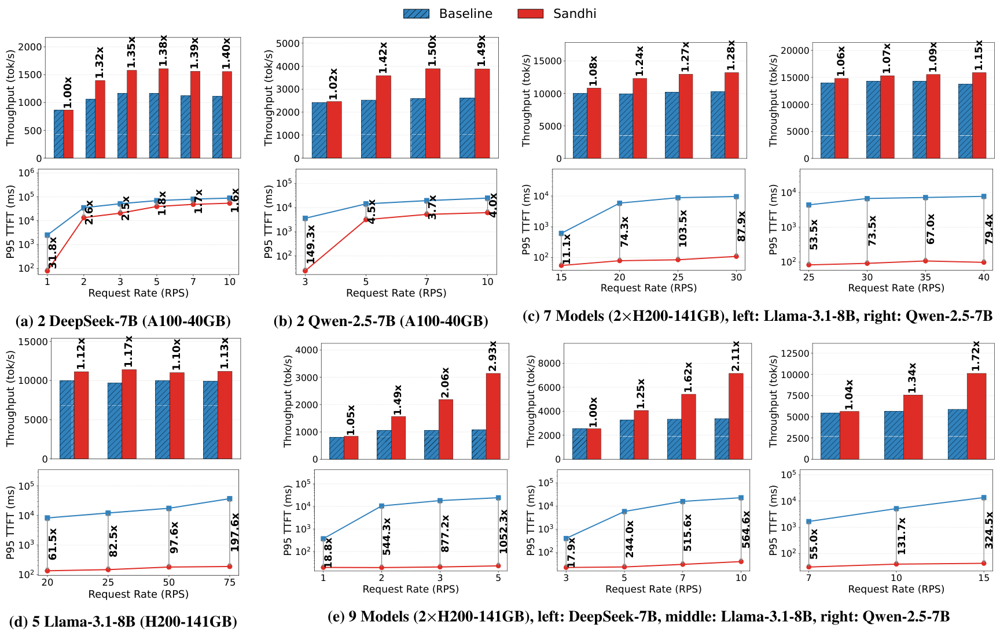
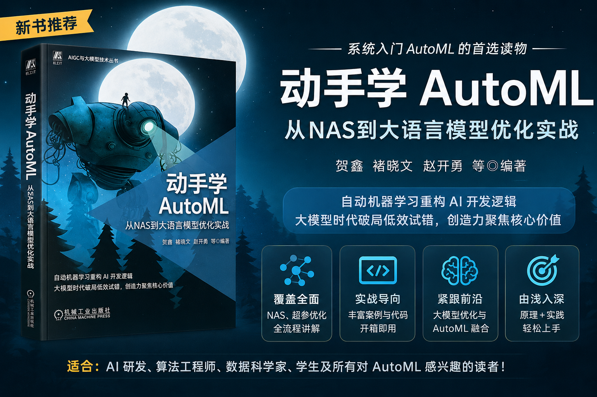

# SOSP'26 | SANDHI：用细粒度模型融合，缓解多模型服务的显存困局

> 原文：[SANDHI: Fine-Grained Merging for Memory Efficient Multi-Model Serving](https://doi.org/10.1145/3830418.3843911)
>
> 源码：[作者官方 artifact，固定版本](https://github.com/VimaGupta345/sandhi-artifact/tree/2b24887e8cd2de9c3fdf8897bf91451be514c87b)。下文区分论文报告与 artifact 修订结果，不把源码核验当成 GPU 实验复现。

---

## 1. 五个专用模型，为什么还没把 GPU 算满，显存就先满了？

假设一个平台要同时部署医学、法律、财经、安全检查和真实性判断五种服务，各挑一个合适的 fine-tuned 模型，也就是在基础模型上继续训练、适配专门任务的版本。单看每个模型都不大，放到一起，账就不太好算了。

论文里的五个 Llama-3.1-8B 变体，仅权重就大约需要 80GB。服务还得给 KV cache 留位置——它保存每个请求在 attention 中已经算过的 key/value，避免每生成一个 token 都重算历史。并发请求越多、上下文越长，这部分内存越大。结果往往是计算资源还有余量，却已经装不下更多请求。

最直接的补救是把部分权重放到 CPU 内存，需要时再搬回来，也就是 offloading。但省掉的 GPU 显存，要拿 CPU–GPU 传输延迟来换。另一个办法是 LoRA，即低秩适配：保留一份基础权重，每个任务只存一个小增量。问题是，别人发布给你的可能是完整微调 checkpoint，而不是 adapter；几款模型也未必来自同一个 base。

SANDHI 换了一个角度：**既然这些模型要一起服务，能不能让其中一部分权重住同一份显存，而不是每个 checkpoint 都完整交一遍房租？**

这里有两个容易误解的地方。它不是把所有专用模型揉成一个万能模型，也不是发现字节完全相同的参数后做普通去重。它允许有选择地修改参数，让多个模型共享融合后的组件，同时保留各自的模型入口和未融合部分。代价是必须重新验证任务质量。

下面用两个模型、每个三个组件画一个教学示意。先看上排各自完整保存的参数，再沿中间的验证流程走到下排；这里的 A1、A2 只是抽象组件编号，不代表实际层号。

上排的 A2、B2 原本分别存储，下排在兼容检查、融合和逐模型评测之后，才让两个逻辑模型引用同一个共享组件。A1、A3 与 B1、B3 仍然各自保留，请求状态也没有合并。这张图表达的是论文要实现的目标；公开 artifact 中校正后的参数是否还能保持同一份物理存储，后面还会具体核对。

## 2. 共享参数不难，难的是别把专长一起平均掉

通常说的 model merging，是不重新训练或少训练，把多个模型的参数组合起来，希望得到兼具不同能力的模型。最朴素的示意是：

$$
W_{\mathrm{merge}}=\frac{1}{k}\sum_{i=1}^{k}W_i.
$$

几个同形状矩阵合成一个，存储确实少了。但参数能做平均，不代表功能也能取并集。某个模型恰好靠一部分权重学会法律术语，另一个模型在同一位置编码的是别的东西，平均之后，谁的专长都可能受影响。

论文用全模型融合做对照，发现部分专用任务的准确率会大幅下降。这个结果不奇怪：传统融合更关心得到一个新模型，多模型服务却要求**原来的每一个模型都还能把自己的活干好**。平均成绩不错，也不能拿一个医学模型的进步去抵消另一个法律模型的退步。

所以 SANDHI 不把整层作为不可拆的单位。Transformer 的一个 decoder block 中，attention 负责 token 之间的信息交互，MLP 是逐 token 的前馈网络；同一层的两者，对任务的敏感程度可能完全不同。

再往下，attention 有 query/key/value/output 投影，也就是 Q、K、V、O；MLP 则有 gate/up/down 等投影。SANDHI 的 **profiling 以 attention、MLP 组件为粒度，实际候选聚类和融合会下探到这些投影矩阵**。不能把这两个粒度混成一句“按层共享”。

这也解释了它与 LoRA、去重的区别：LoRA 用一个小的低秩增量表达任务差异；普通去重只让本来相同的数据共用物理存储；SANDHI 先通过融合创造可共享的参数，再用内存映射消除副本。前半段改变模型行为，后半段才是系统层的共享。

因此，“不需要原始训练数据”不等于“不需要数据”。它不靠重新 fine-tune 来修复融合结果，**但需要能代表各模型任务的评测数据，决定哪些修改可以接受**。

## 3. 不先找另一个模型，先测试自己哪里经得起折腾

要决定两个组件能否融合，直觉上会先比较参数相似度。但模型池一扩大，两两分析的成本就上来了；而且权重看起来接近，也不保证融合后任务表现接近。

SANDHI 的观察比较有意思：与其先问“你和谁像”，不如先问“你自己哪里对扰动不敏感”。

具体地，对一个权重矩阵 $W$，生成与它均值、标准差相匹配的高斯噪声 $Z$，然后用下面的权重临时替换它：

$$
Z\sim\mathcal{N}(\mu_W,\sigma_W^2),\qquad
\widetilde W=\frac{W+Z}{2}.
$$

对某层 attention 或 MLP 内的相关矩阵做这个操作，评测任务准确率，再恢复原权重。准确率掉得少，说明这个组件比较经得起参数扰动，可以优先尝试融合。源码中的 `_generate_noise_like_weight` 和 `_perturb_and_eval` 核实了这条路径：锁定实验使用 `avg`，不是随便加一份未经缩放的噪声。

下面这张原图，横轴是被扰动的层号，纵轴是任务准确率，越高越好。先看灰色虚线的原模型基准，再分别看只改 attention、只改 MLP，以及两者一起改的曲线；左右是财经与真实性判断两个模型。

左图大多数位置离基准不算太远，但某个位置的 attention 准确率直接跌到底；右图早期层整体更敏感，中后部很多组件则贴近基准，同时又有单个 MLP 的深坑。**同层不同组件、同一模型不同位置，不能一刀切。**

这张图支持的是“噪声敏感性有助于筛选候选”，不是“随机权重和另一个模型等价”。尤其两个单独看都不敏感的修改，放在一起可能互相干扰。后面逐步评测、失败回滚，才是守住质量的关键。

好处是每个模型可以独立做 profile。新增模型不必先与池子里每个旧模型逐对跑一遍重要性分析。但它仍然要参与后续融合与校验，不能理解成接入新模型只做一次单模型测试就完事了。

## 4. 跨 family 可以尝试，但先过形状、尺度和精度三道关

论文的“跨模型 family、跨尺寸”很容易让人兴奋，也最容易被写过头。**能在异构模型池里寻找共享机会，不代表任意两个模型、任意两层都能合并。**

首先必须是兼容的组件类型和 tensor 维度。输入输出维度对不上，矩阵连平均都做不了；hidden dimension 相同，也不代表所有 attention 投影或 MLP 中间维度都相同。层号则不必严格对齐：一个模型的某层投影，可以与另一个模型不同层号的同类兼容投影成为候选。

作者的 artifact 把实际边界写得很具体：Llama 与 DeepSeek 两组隐藏维度都是 4096，可以探索兼容组件的跨 family 融合；Qwen2.5-7B 的隐藏维度是 3584，Qwen3-32B 是 5120，在这里的模型池中不能与其他组交叉共享。12 模型的结果包含不同组收益的组合，**不是十二个模型一起共用一套主干**。

过了形状关，还要过尺度关。即使两个矩阵形状相同，参数的幅度分布也可能差很多，融合会改变输出 hidden state 的尺度。残差连接会继续把这种变化传下去，并不保证下一层立刻修好。

论文描述在融合组件输出处加入轻量 scaler，维持 hidden state 的尺度。公开实现则采用另一种落地方式：`_n_way_average_subcomponent_into_target` 先用 FP32 累加并平均，再按目标矩阵每个输出行的均值、标准差做仿射校正，缩放比限制在 0.1 到 10 之间，最后把校正烘焙进权重。

**这里存在一个关键缺口：不同目标模型的校正结果可能不同，它们就不能直接映射为同一份物理权重。** 论文的“共享矩阵加输出校正”原则上可以同时照顾两者，但公开 artifact 的 baked 变体、参数记账和 serving 映射，尚不能据此证明质量与共享收益在同一个配置里同时兑现。后面的算法与服务路径，需要带着这个区别读。

整个过程可以沿下面的架构图从左往右读：左边是单模型扰动测试，中间是候选分组和逐次尝试，右边才是服务时选择配置。

左侧先把对噪声不敏感的组件放入 profile store。中间按照组件类别、维度和参数幅度统计分组，用 Ward 层次聚类——每次优先组合能让组内差异增加较小的候选——产生共享集合。Q、K、V、O 和 MLP 各类投影分别处理，不是把所有矩阵倒进一个池子。

然后按顺序尝试融合：能够节省更多显存的候选优先，MLP 通常比 attention 更大；中部层优先于输入输出附近的层；相邻层、同一 block 的敏感修改尽量错开，避免扰动连续叠加。图中绿色勾表示修改通过评测，红叉则表示回滚。右侧最终拿到的不是一个唯一成品，而是一串精度与显存占用不同的配置。

这是一套启发式搜索。它把“不知道合哪里”转化为“优先试哪些”，并没有证明找到全局最优解。

## 5. 贪心试探之后，还要对每个模型重新算账

搜索空间到底有多大？如果两个模型各有 $L$ 层，每层只对 attention 和 MLP 做“合/不合”二选一，已经有：

$$
2^{2L}
$$

种组合。$L=32$ 时是 $2^{64}$。论文概述里出现“数十亿”的粗略表述，但正文按两个组件独立决策给出的完整计数更大；开放跨层、跨模型分组后，问题只会更复杂。

SANDHI 不枚举这些组合，而是沿排好的候选序列前进。每次修改后测任务表现，可以接受就保留，不行就撤销，再继续尝试。这个过程叫 MICR，展开就是 Merge-Incrementally-Check-Rollback，增量融合、检查、回滚。

质量要求可以写成：对每个模型 $m$，选中的配置 $v$ 都需要满足

$$
A_m(v)\ge A_m(0)-\rho_m.
$$

这里 $A_m(0)$ 是原模型的任务得分，$\rho_m$ 是用户允许的绝对准确率下降预算。以 2 个百分点为例，80% 下降到 78% 才是这个口径，不是相对下降 2%。预算也不是“每个请求的答案都与原模型一样”，只是评测指标约束。

源码还有个值得留意的细节：MICR 的局部接受逻辑与最终预算筛选不是同一件事。`run_eval.py` 比较新分数与已接受历史中的最低分，局部通过不自动等于相对原模型的累计下降始终不超预算；后续 `build_operating_points.py` 还要根据原始基准，为每个模型筛选预算内的 cutoff，即融合轨迹截断位置。**不能只读到一个 `accepted`，就宣布全局精度约束已经成立。**

下面看这组精度—显存曲线。横轴越右省得越多，纵轴是模型池平均任务得分的变化；先看散点，再看黑色前沿和红星。红色虚线表示图中设定的精度下界。

灰点说明尝试过的方案并非都划算：有的省得不多却掉分更多。黑线保留了更值得选择的方案，红星是用于后续吞吐实验的 operating point。曲线也并非一路平滑向下，某些融合会略微提分，继续修改又可能退步。

但图的纵轴是**平均值**，真正选点仍要检查每个模型是否达标，不能靠这张图直接证明所有成员都安全。另外，同一篇论文不同实验可能选不同配置：这里五 Llama 的红星标了 34.8GB，前面的主比较用约 28GB，不能把不同 operating point 的数字随手拼起来。

artifact 将数据分成用于 profiler 与 MICR 的两份，最后另做全数据评测。这比拿同一小样本一路筛到底更合理，但多次搜索仍可能适应校验集。尤其生成任务，即使 temperature 为零，评测后端也未必逐位确定；边界附近一题翻转，就可能改变一次接受决策，进而改变整条后续轨迹。

## 6. 请求进来以后，不会再现场融合一遍

离线步骤完成后，系统保存可用变体及共享 spec。在线请求仍然指定一个逻辑模型，进入对应的 vLLM 推理实例；输入先被该模型处理，经过自己的未共享权重，以及 spec 指向的共享权重，完成首轮 prompt 计算，再逐 token 生成输出。

共享的是参数，不是请求的计算结果。两个模型用了同一矩阵，不代表这两路请求的输入相同，也不代表 KV cache 可以共用。各实例仍要保留自己的请求队列和执行状态。

参数共享如何真正省下显存？SANDHI 使用 CUDA 的虚拟内存管理接口 VMM，让多个进程的虚拟地址映射到同一份物理 GPU 内存。固定版本 serving 源码里的 `VMMCompositeWeight` 确实会保留连续虚拟地址，分别装入本地或其他进程导出的物理块；`DefaultModelLoader._setup_vmm_sharing` 则读取 spec，将 QKV 等融合投影里的指定子块映射过来，并跳过对应的重复装载。

所以对计算 kernel 来说，拿到的还是预期布局的 tensor，不需要把每一次矩阵乘都改成“先去另一个模型借权重”。不过这条核验只证明静态共享装载路径：**若映射的是 owner 的权重，就必须重新确认它与各消费者评测过的最终权重一致。** 有共享 spec，不等于目标相关校正已经被正确保留；也不能顺带证明论文所有在线自适应机制都已公开实现。

论文的 runtime 关注的是几分钟到几小时的模型请求比例漂移，不是每一个流量尖峰。它用指数移动平均追踪各模型请求率，在十分钟窗口里，请求分布的总变差距离超过 0.2 才触发切换；这个距离衡量两份请求比例相差多大。

流量大时，可以选更省显存的已验证变体，给 KV cache 腾地方；压力小时，则能减少共享、换回更好的精度，或者保留空间容纳更多模型。热点模型也不必与冷门模型采用完全对称的策略。**省出的空间可以换并发，也可以换模型数量，但不能同一份空间两头都花。**

论文提出用新旧实例并存、后台取权重、旧请求排空后重新绑定的方式切换，旧新实例保留独立 KV cache。双 DeepSeek 案例报告取权重 31ms、原子指针切换 0.61ms；首 token 延迟及每输出 token 时间的 P99，即 99% 请求不超过的值，保持在基准 2% 以内。这是特定案例，不是所有模型切换都只花半毫秒；公开 artifact 主要提供静态 operating point 部署与压测，本文没有据此声称完整在线控制器已复现。

## 7. 最高省近一半，收益究竟出现在哪里？

主实验覆盖三个模型 family、12 个微调模型、9 个 benchmark，默认使用 H200。下图先看各组最左边的显存柱，再看右侧各任务准确率：红色是 SANDHI，蓝色是分别部署，橙色和绿色是论文的 LoRA 与全模型融合对照。

左上三个 Qwen3-32B 的论文结果是最高 49.8%；右上五个 Llama-3.1-8B 节省 35.2%；中间 Llama 加 DeepSeek 的七模型池为 26.7%；底部十二模型池为 38.0%。异构池里的叉号表示这些对照在该跨 family 配置下不适用，不是跑出来得零分。

同时看红蓝准确率柱：有的任务融合后略升，有的下降。这才是“在用户容差内”的含义，**不是普遍无损，更不是生成文本逐 token 不变**。LoRA 也不能被这组对照简单判死刑：artifact 使用具体的 rank-128 adapter，其结果不代表所有正确训练、充分调参的 LoRA 都输给融合。

这里必须补上作者 artifact 的修订。固定 commit 的 `CHANGES.md` 明确说，Qwen3-32B 对应点按完整磁盘模型大小 192GB 作分母，节省 92.6GB，应报告 **48.2%**；论文的 49.8% 使用了 186GB 分母。这个修订不改变该案例从两张 H200 缩到一张的容量结论，却意味着“49.8%”不能当成没有口径问题的宣传数字。

性能收益则主要来自更晚进入显存饱和，而不是矩阵乘突然快了几倍。下图每个场景的上图是每秒输出 token 数，越高越好；下图是 P95 TTFT，即 95% 请求的首 token 等待时间不超过的值，越低越好，纵轴还是对数刻度。优先看底部九模型场景的三组曲线。

随着请求率增加，蓝色吞吐先到平台，蓝色等待时间开始猛涨；红色还有 KV cache 余量，可以继续接请求。底部 DeepSeek、Llama、Qwen 三组最高吞吐提升分别是 2.93×、2.11×、1.72×。DeepSeek 的 P95 TTFT 最高改善约 1052×，但这是基准发生严重排队后的比值，**不能理解成一次不排队的 forward 快了一千倍**。

原图 caption 把部分 Llama 数字归给 Qwen，作者在 artifact 中已指出；这里按图中曲线与正文对应。更重要的是，两 Qwen2.5 场景在当前 artifact 被标为仍在调查、建议跳过，不能把上图那一格当成已稳定复现的证据。参考 serving 实验两边都开启了 kvcached 弹性 KV 分配，也不是“普通静态 vLLM 对比一个换了全部内存管理的新系统”。

双 DeepSeek 的参考 serving 还暴露了质量与共享之间的具体冲突：为保证权重逐字节相同、能真正去重，它关闭了前面的目标相关校正。但 artifact 的全数据得分表中，Math 模型从 81.3% 降到 78.5%，下降 2.8 个百分点，超过所设的 2 点预算；开启校正时为 79.3%。这不直接推翻论文原始性能报告，却意味着**不能将校正版的质量验证与无校正版的服务收益拼成同一个已证实结果**。

显存容量还有跨门槛效应。论文报告，两个 Llama 模型在 A100-40GB 上从需要 offloading 变成能驻留 GPU，吞吐约从 75 到 1300 token/s，改善约 17×；这里不是同一个“最高 2.93×”实验范围，后者讨论模型已装得下时扩充 KV 的收益。至于仍需 offloading 的案例，减少搬运量也能有帮助，但 artifact 还记录了该组论文模型名待修订，不宜拿那一组作为跨架构泛化的证据。

## 8. 显存不是白捡的，搜索和可信校验都要付费

profile 去掉了两两比较，不等于没有离线成本。每层分别测 attention、MLP，就要反复跑任务评测；论文估计 profiling 与后续评测阶段各自至多需要约 $2L\,t_{\mathrm{eval}}$，单次评测通常 1–5 分钟。实际总账还取决于模型数、候选数、评测集大小、可并行 GPU 数，以及保存、装载 checkpoint 的开销。

论文的五 Llama 案例，MICR 用 20 分钟逐步产生变体，模型任务并行运行，每模型使用两张 H200。这个例子不能缩写成“整套方法只需 20 分钟”，更不是一张卡上的冷启动总成本。模型池变得越频繁，离线成本越难摊薄；新模型 profile 可独立复用，但新增共享候选仍需重新验证。

回滚同样不是可有可无。论文去掉回滚后平均准确率下降约 8%，DeepSeek 最坏约 30%。只按整层融合的五 Llama 消融节省 24.9%，细到组件后为 35.2%；粗粒度平均掉约 1.9 个百分点，细粒度平均变化约为 +0.53。说明价值不是“做了平均”这件小事，而是**选对粒度，并为组合后的干扰持续买单**。

它也能与其他压缩办法叠加，但要看清分母。LoRA 叠加实验减少的是约 44.7% 的 adapter overhead，不能说整套模型又省了 44.7%；量化实验是相对未量化基准的累计节省从 43.2% 到 59.6%，不是在量化后总显存上再直接减 16%。MoE，也就是每个 token 只激活部分专家的模型，论文扩展案例节省 14.1%，平均准确率约降 0.62 个百分点；它证明可以探索专家粒度共享，不证明所有专家模型都同样好合。

还有最后一层工程边界：融合 recipe 相同不等于最终 tensor 真正一致。artifact 的容量估算按 contributor recipe 识别共享组，并为部分校正向量扣除空间；这不是逐字节验证 baked 权重相同。若要只存 canonical 平均矩阵并在线重建目标相关变换，就还需要保持共享的执行实现；若装载时重建完整矩阵，那份矩阵仍要占显存。

跨 family 也有相同的证据边界。固定 artifact 的说明明确指出，跨 family recipe 在当前记账中不匹配，没有形成跨 family 共享组。因此七模型、十二模型异构池的总节省，可以来自各 family 内共享收益的相加，**不能拿它证明 Llama 和 DeepSeek 之间的物理去重已经兑现**。这些问题不抹杀组件级融合的研究价值，但复用时必须把“候选能合”“质量能过”“物理上真省”分别验完。

## 9. 总结：模型边界不必等于物理存储边界

SANDHI 最有启发的地方，是没有把 checkpoint 当成不可拆的部署单位。一个服务仍然可以保留自己的逻辑模型，同时把对任务不太敏感、形状兼容、经过验证的局部参数，与别的模型共同存放。

但这里的边界一条都不能省：**兼容维度只是入口，噪声鲁棒只是线索，MICR 是受顺序影响的贪心试探，最终质量约束依赖评测集与用户容差。** 它并不保证任意 family 都能融合，也不保证某个 benchmark 守住了，就能覆盖线上长尾、分布漂移和安全要求。

真正适合考虑这条路的，是模型池相对稳定、显存长期紧张、又能为每个专用模型提供可信校验任务的服务。此时花一笔离线搜索成本，把参数冗余换成 KV cache 或更少的 GPU，可能很划算。如果业务要求严格保持原模型输出，或者没有办法可靠验证每个模型的能力，这笔交易就没有那么容易成立。

从这个角度看，它不是“再来一个压缩算法”，而是在问：**多模型服务里，哪些参数必须属于某个模型，哪些只需要以合适的形式存在一次？** 这个问题，比最高省了多少百分比更值得继续挖。

---

顺带一提，如果想从算法角度系统了解模型融合，我们的《动手学 AutoML：从 NAS 到大语言模型优化实战》确实包含这一方向：第 8 章介绍 LLM 架构自动化、压缩与模型融合，也讨论怎样把模型优化变成可搜索的问题。SANDHI 的 CUDA VMM 和多模型 serving 工程不是书里的内容，但从搜索空间、候选评估到精度约束这条思路，可以接着读。

> 
