# MoE 推理与 speculative decoding：从“为什么会变慢”到 expert-aware 的系统优化

> 论文：
> [Utility-Driven Speculative Decoding for Mixture-of-Experts](https://arxiv.org/abs/2506.20675)
> · [SP-MoE: Speculative Decoding and Prefetching for Accelerating MoE-based Model Inference](https://arxiv.org/abs/2510.10302)
> · [Speculating Experts Accelerates Inference for Mixture-of-Experts](https://arxiv.org/abs/2603.19289)
> · [DraftExpert: Expansion-Aware Self-Speculative Decoding for End-Device MoE Inference](https://arxiv.org/abs/2607.24434)

---

## 1. speculative decoding 在 MoE 上为什么会突然失灵？

speculative decoding 的基本想法很简单：先用一个便宜的 draft model 连续猜 $K$ 个 token，再让更大的 target model 一次性验证。如果猜对了多个 token，target model 每次 forward 就能产出更多结果，平均每个 token 的时间自然下降。

在 dense LLM 里，这个逻辑比较顺。因为每次推理几乎都要读取整套模型权重，验证 $K$ 个 token 主要是多做一些 GPU 上的计算，但不会让“要搬进 GPU 的模型权重集合”突然膨胀。

MoE，也就是 Mixture-of-Experts，情况不一样。它把 FFN 拆成很多个 expert，每个 token 只由 router 选出少数几个 expert 计算。稀疏激活减少了单个 token 的计算量，但也带来一个容易被忽略的系统事实：**每个 token 访问的是不同的 expert 权重**。

如果所有 expert 都放在 accelerator 显存里，问题还不算太严重；但当模型太大，只能把 expert 权重放在 CPU 内存、Flash 或其他较慢的存储层时，decode 就会变成：

```text
router 选 expert
    ↓
把 expert 权重搬到 accelerator
    ↓
执行 MoE
    ↓
换到下一层，继续搬
```

普通自回归 decode 每轮只处理一个新 token，所需 expert 集合相对有限。speculative decoding 一次验证 $K$ 个 token 时，target model 需要处理这些 token 的 expert 并集：

$$
\mathcal{E}_{\mathrm{verify}}
=
\bigcup_{i=1}^{K}\mathcal{E}(x_i).
$$

$K$ 变大，接受的 token 数可能变多，但 $\mathcal{E}_{\mathrm{verify}}$ 也可能快速变大。结果就是：**speculation 带来的 token 收益，可能抵不过额外的 expert 搬运成本。**

图 1：MoE 上 speculative decoding 的额外搬运成本。左侧 dense LLM 的 verification 不会明显增加模型权重搬运；中间 MoE 的多 token verification 会扩大 expert 集合；右侧是 Cascade 观察到的静态 $K$ 可能导致 slowdown。

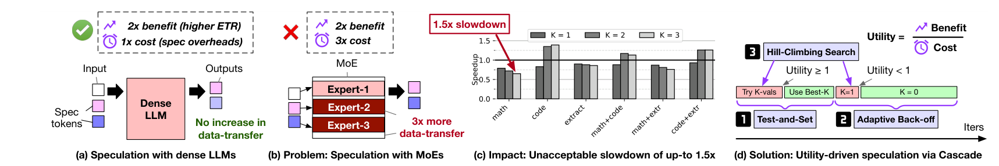

上图怎么读：左边是 dense LLM，draft token 并不会引入额外的模型权重搬运；中间是 MoE，多个 draft token 会激活更多 expert，验证阶段的数据搬运从一次变成一组；右边的结果说明，静态选择一个 $K$ 并不安全，某些任务上甚至会变慢。

所以这四篇论文真正共同面对的问题不是“怎样让 speculative decoding 猜得更准”，而是：

> **在 MoE 里，一个被接受的 token 到底值不值得为它多搬运一批 expert？**

这句话把四篇论文串了起来。它们的解决层次不同：

- `Cascade`：先在线判断这次 speculation 是否值得，以及 $K$ 应该取多少；
- `Speculating Experts`：既然要搬 expert，就提前预测下一层会用谁，把搬运和计算重叠起来；
- `SP-MoE`：把 prediction 前移到 drafting 阶段，用 draft 阶段的空闲 I/O 预算预取 target expert；
- `DraftExpert`：进一步改造 drafter，让它保持固定的搬运预算，同时提高接受率，并控制验证时 expert 集合的膨胀。

这不是四个互相替代的算法，而是一条从控制策略、运行时 prefetch，到 drafter 设计逐渐深入的路线。

## 2. 先建立统一视角：MoE speculative decoding 的成本账本

把一次 speculative iteration 拆开，至少有四笔成本：

```text
draft cost
    ↓
draft token acceptance
    ↓
verify cost
    ↓
expert movement cost
```

其中最后一笔是 MoE 特有的麻烦。对 dense model 来说，verify $K$ 个 token 主要增加计算；对 offloaded MoE 来说，verify $K$ 个 token 还会扩大需要加载的 expert 集合。

可以用一个简化的收益比表示 speculation 是否值得：

$$
U
=
\frac{\text{speculation 带来的 token 处理收益}}
{\text{draft 与 multi-token verify 的额外成本}}.
$$

当 $U>1$ 时，speculation 才可能降低平均 TPOT。TPOT 是 time per output token，也就是生成每个输出 token 的平均时间，越低越好；当 $U<1$ 时，speculation 的额外工作已经超过了它节省的时间。

这个 $U$ 不是一个固定的模型属性。它会随模型、任务、请求阶段、$K$、GPU/CPU 带宽和 expert cache 命中情况变化。也就是说：

> **MoE speculative decoding 的第一层优化，不是设计一个永远正确的 $K$，而是承认 $K$ 本来就不应该固定。**

四篇论文的路线图如下。先看最上面的瓶颈，再沿着四个编号从左向右读：先做决策，再隐藏搬运，最后修改 drafter。

图 2：四篇论文对应的四层优化路线。它们依次控制 speculation、隐藏 expert transfer、利用 draft-stage 的预取窗口，并重新设计 drafter。

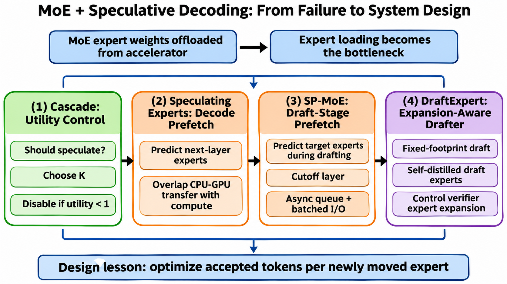

如果把一次 speculative iteration 展开，读者需要同时跟踪三条线：draft token 如何产生，target verification 如何扩大 expert union，以及 runtime 如何根据 utility 决定是否继续。下面这张框图把三条线放在同一张图里。

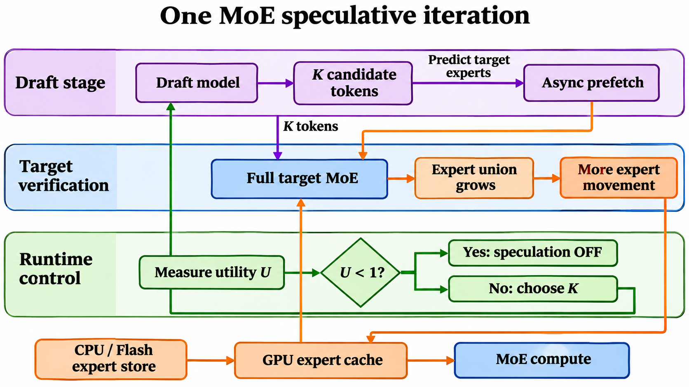

图 3 从上到下看：draft 阶段先生成 $K$ 个候选 token，并把预测到的 target expert 放入异步 prefetch；中间的 target verification 仍然要处理这些 token 对应的 expert union；底部的 runtime control 则根据 $U$ 决定关闭 speculation 还是选择新的 $K$。最下面的 CPU/Flash 到 GPU expert cache 是所有方法共同争夺的实际数据通路。

## 3. 第一层：Cascade 先解决“这次到底要不要 speculate”

### 3.1 dense LLM 的经验不能直接搬到 MoE

在 dense LLM 上，常见做法是离线测试一个固定的 $K$，比如固定使用 $K=3$ 或 $K=5$。但 Cascade 的实验说明，MoE 上固定 $K$ 很容易失效：

- 不同模型的最优 $K$ 不一样；
- code、math、extraction 等任务的最优 $K$ 不一样；
- 同一个请求在生成早期和后期的 utility 也可能不同；
- mixed workload 中，一个请求适合 speculation，不代表下一个请求也适合。

论文在五个 MoE 和多种任务上观察到，speculation 可能带来 1.5 倍级别的 slowdown。问题不在于 draft token 完全没猜对，而在于验证这些 token 时激活的 expert 太多，数据搬运和 verify cost 反而把收益吃掉了。

### 3.2 utility 是一个运行时的刹车和油门

Cascade 的核心是把 speculation utility 作为运行时信号。它并不试图预测一个永远最优的静态 $K$，而是周期性地做一小段测试：

```text
test phase:
    试几个 K
    测量 token 收益与 verify cost
    计算 utility

set phase:
    utility < 1 → 暂时关闭 speculation
    utility > 1 → 使用当前最优 K
    下一轮再测试，防止请求阶段发生变化
```

图 4：Cascade 的运行时控制器。

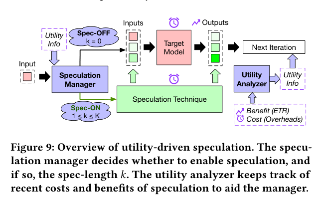

图前先说怎么读：左边是输入和 speculation manager，中间是可选的 speculation technique 和 target model，右边的 utility analyzer 把本轮收益和成本反馈给 manager。这里真正被动态控制的不是 target model，而是 speculation 的开关和长度。

图后沿着数据流走一遍：如果 manager 选择 `Spec-OFF`，请求直接进入 target model；如果选择 `Spec-ON`，系统产生 draft tokens，再把它们交给 target model 验证；utility analyzer 记录 ETR，也就是 effective token rate，和 verify overhead，最后把结果反馈给下一轮决策。

Cascade 还有两个很工程化的设计：

1. **adaptive back-off**：如果 utility 持续低于 1，就逐渐拉长 set phase，减少频繁测试带来的额外成本；
2. **hill-climbing**：当 utility 大于 1 时，根据不同 $K$ 的变化方向搜索更好的 speculation length，而不是把所有可能的 $K$ 都暴力试一遍。

论文报告中，Cascade 将最坏 slowdown 限制在约 5%，相较静态策略可能出现的 1.5 倍 slowdown 安全得多；在 speculation 确实有效的场景中，相比静态 $K$ 还能带来约 7%–14% 的 throughput 提升。

Cascade 的贡献因此更像一个控制面：

> **它没有让 MoE 的 expert 搬运消失，而是先避免在不值得的地方启动搬运。**

## 4. 第二层：Speculating Experts 把 expert 搬运藏到计算后面

Cascade 解决了“要不要 speculation”，但如果答案是“要”，expert 权重还是要搬。最直接的优化就是预测下一层会用哪些 expert，然后在当前层计算时把它们提前搬过来。

### 4.1 预测的对象不是下一个 token，而是下一个 expert 集合

在一个 pre-norm MoE block 里，当前层经过 attention 和 residual 后会得到 normalized residual。论文把它和一个 default vector 组合成 quasi-hidden state，再送入下一层的 router，用来预测下一层的 expert。

图 5：Speculating Experts 用当前层的内部表示预测下一层 expert。

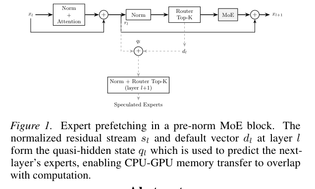

这张图要看两个箭头：上面的实线是当前层正常执行，下面的虚线把当前层已经算出的表示送进下一层 router。于是 GPU 正在算当前层 MoE 时，CPU 到 GPU 的 transfer 可以提前开始。

预测结果不需要百分之百正确。只要高权重的 top-ranked expert 能被提前搬过来，关键路径上的等待就会减少。论文还观察到，低排名 expert 即使预测错误，对最终输出的影响通常较小。

### 4.2 它和普通 cache prefetch 的区别

很多系统把 prediction 当作 cache hint：预测错了，就再把真实 router 选中的 expert on-demand load 一遍。这样虽然不影响模型正确性，但错误 prediction 会重新出现在关键路径上，compute 和 transfer 的重叠程度有限。

`Speculating Experts` 更激进：在一部分设置中直接执行预取到的 expert 及其 routing weight，而不是把 prediction miss 全部当作 cache miss。这个选择的依据是，高排名 expert 的预测相对可靠，而且多个 expert 的权重贡献并不一样。

最终收益来自时间线，而不是来自单纯的 hit rate：

```text
没有 prefetch：
    等 expert transfer → 执行当前层 → 再等下一层 transfer

有 prefetch：
    transfer 下一层 expert
                 ↘
    执行当前层 MoE ─→ 下一层直接使用
```

图 6：expert transfer 与计算重叠。

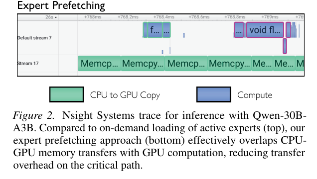

图前先看上面的时间线：绿色是 CPU 到 GPU 的拷贝，蓝色是计算。下方的 prefetch 方案把绿色拷贝塞进了蓝色计算的空隙里，减少 transfer 出现在 critical path 上的时间。

论文在多个 MoE 和硬件配置上报告了约 5%–14% 的 TPOT 降低；在 Qwen3-30B-A3B 上，较弱的 A6000 上收益达到约 12%–14%，而更快的 A100、GH200 上约为 5%–8%。这很符合系统直觉：GPU 越快，计算越难覆盖搬运时间，prefetch 的相对收益反而越小。

这篇工作的关键 insight 是：

> **预测 expert 的价值，不只在于少一次 miss，而在于把本来串行的“搬运 → 计算”变成“搬运和计算同时发生”。**

## 5. 第三层：SP-MoE 把预取窗口前移到 drafting 阶段

前一篇方法主要利用当前 decode step 中已经产生的表示，去预取后面的 expert。`SP-MoE` 进一步利用 speculative decoding 自己提供的时间窗口。

一次 speculative iteration 本来就分为：

```text
draft model 产生多个 token
        ↓
target model 并行验证这些 token
```

在 draft model 运行期间，target model 还没有开始验证。这个阶段如果 I/O 没有被充分利用，就存在一段可以拿来提前搬运 target expert 的预算。

### 5.1 SP-MoE 的预测器和 cutoff layer

SP-MoE 使用 draft model 的 attention output，接入 target model 对应层的 gating network，预测 target model 接下来会激活哪些 expert。因为 draft model 和 target model 在层结构上有对应关系，draft 阶段的 hidden state 可以提供比历史频率更及时的信号。

但“能预测”不等于“应该把所有预测结果都搬过来”。预取太深会带来两个问题：

- GPU 显存装不下所有预取 expert，导致 cache thrashing；
- CPU–GPU 带宽被预取任务占满，反而影响真正需要的 expert。

所以 SP-MoE 引入 cutoff layer，只对 cutoff 之前的层做 drafting-stage prefetch。cutoff 由 expert 大小、GPU 容量、计算时间和 I/O 时间共同决定，目标是让预取在 target verification 需要 expert 之前完成，同时不把未来太远的 expert 提前塞进 cache。

图 7：SP-MoE 的 draft、verify 和 prefetch 数据流。

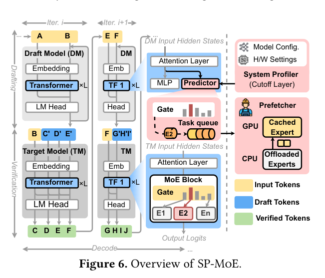

图中左侧是 draft/verify 的双阶段流程，中间的 predictor 使用 draft hidden states 产生 expert 任务，右侧 prefetcher 把 CPU 中的 expert 搬到 GPU cache。这里的关键不是再加一个 predictor，而是把 predictor 放在 draft 阶段，并让它和 target model 的 verification 对齐。

### 5.2 异步 worker 让 prefetch 真正连续起来

如果每预测一组 expert 就立刻同步等待，预取仍然会插入主计算路径。SP-MoE 使用异步 worker、独立 CUDA stream、任务队列和 batched I/O，让 prediction 线程只负责产生任务，worker 在后台持续执行：

图 8：SP-MoE 的异步 prefetch pipeline。

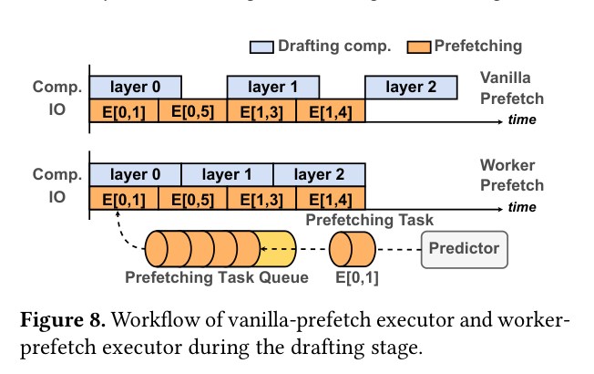

上半部分是 vanilla prefetch：每一层计算和预取交替，容易出现等待；下半部分是 worker prefetch：预测出来的 expert 被放进队列，后台 worker 连续处理，draft computation 尽量覆盖加载时间。

SP-MoE 的实验报告在不同模型、数据集和环境上取得约 1.07×–3.5× 的 TPOT speedup。这个范围很宽，反而说明它不是一个脱离硬件的固定倍数：expert 大小、GPU 显存、I/O 带宽、draft token 数和 cutoff layer 都会改变收益。

`Speculating Experts` 和 `SP-MoE` 的差异可以这样记：

| 维度 | Speculating Experts | SP-MoE |
|---|---|---|
| 预测时机 | 当前 decode 计算中预测后续层 | draft 阶段预测 target verification |
| 预测信号 | 当前模型内部表示、quasi-hidden state | draft attention output + target gate |
| 主要目标 | 隐藏下一层 expert transfer | 利用 draft 阶段额外的 I/O 窗口 |
| 主要控制 | 哪些 expert 值得预取、是否直接执行 | cutoff layer、任务队列、异步 worker |
| 代价 | prediction error 可能影响执行质量 | 预取过深会造成 thrashing 和带宽争用 |

两者都在做 expert prefetch，但它们利用的时间窗口不同。前者优化 decode 内部的 layer-to-layer overlap，后者把 speculation 的两个阶段也纳入了流水线。

## 6. 第四层：DraftExpert 发现，drafter 本身也会把系统拖慢

到这里还剩一个更根本的问题：如果 draft model 为了提高 acceptance，自己也激活更多 expert，那么 draft 阶段就不再便宜；如果 verify $K$ 个 token 的 expert union 太大，target 阶段仍然会被 expansion 拖住。

这就是 `DraftExpert` 的出发点。它把 speculative decoding 的目标从“尽量多猜对 token”改成：

> **在新增搬运的 expert 数量受控的前提下，尽量多获得被接受的 token。**

### 6.1 draft 不能靠简单增加 top-$r$ expert 解决

直觉上，draft 只用 top-1 expert 可能不够准，那就增加到 top-2、top-3。但在 offloaded MoE 中，$r$ 增大意味着更多 expert 权重被加载。论文展示了一个典型 trade-off：

图 9：DraftExpert 观察到的 draft-side expert expansion。

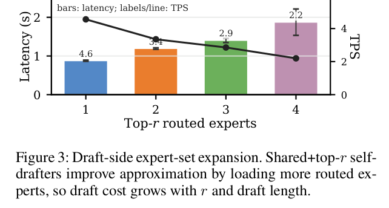

横轴是 draft 使用的 top-$r$ routed experts，柱状图表示 latency，折线表示 TPS。$r$ 越大，draft 的近似能力可能提高，但 latency 也会上升，TPS 反而下降。简单的“多加载几个 expert”并没有真正解决问题。

DraftExpert 因此使用固定 footprint 的 `shared + top-1 + draft-expert` 路径：

- shared components 常驻 accelerator；
- target router 的 top-1 expert 继续参与；
- 每层额外放一个轻量 draft expert；
- 不通过增加 routed expert 数来恢复 acceptance。

这个 draft expert 通过 self-distillation 训练。冻结的 full target MoE 提供 residual、logit/token 和 router-agreement 信号：

- residual loss 让 draft expert 补回被省略的 routed-expert residual；
- logit/token loss 提高下一个 token 的一致性；
- router-agreement loss 让 draft hidden state 更像 target verifier 的 hidden state，从而更容易预测 verify 阶段会用哪些 expert。

图 10：DraftExpert 的整体设计。左侧是 offline self-distillation，右侧是 fixed-footprint drafter、confidence-based truncation、target-expert prefetch 和 full MoE exact verification。

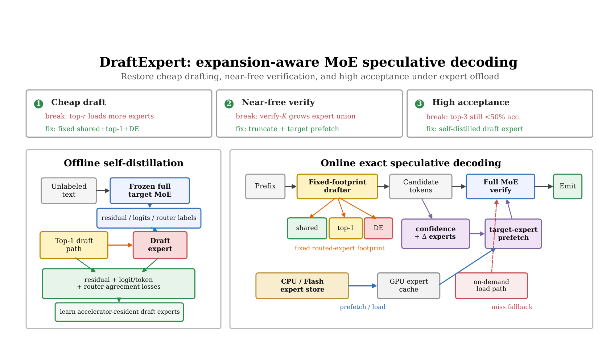

图中左下角是离线 self-distillation，右侧是在线 exact decoding。注意这里的“self-speculative”不是放弃 target model，而是让同一个 target MoE 内部拥有一个轻量 draft path；所有最终输出仍由冻结的 full target MoE 验证。

### 6.2 verify 阶段也要控制 expert expansion

即使 draft 本身足够便宜，验证 $K$ 个 token 仍然可能激活很大的 expert union。DraftExpert 用 confidence–expansion truncation 在生成 draft block 时动态截断：

```text
继续生成下一个 draft token
    ↓
预测它会新增哪些 verifier experts
    ↓
如果新增 expert 太多，且当前 token 置信度又不高
    ↓
提前结束 draft block，进入 target verification
```

同时，draft router 的预测会触发 target-expert prefetch，把高概率的 verifier experts 提前搬过来。这样 DraftExpert 同时控制了两侧：

```text
draft side:
    固定 footprint，避免为了 acceptance 盲目加载更多 expert

verify side:
    控制 expert union expansion，并提前搬运可能使用的 expert
```

论文在 DeepSeek-V2-Lite 和 Moonlight-16B-A3B 上报告了约 1.45× 的平均 decode throughput 提升，draft acceptance 约为 84%–87%，prefetch hit rate 约为 86%–88%。但这个结果依赖端侧单用户场景、CPU/GPU 或 Flash/NPU offload，以及 exact verification；不能直接外推成所有 MoE serving 场景下的统一加速倍数。

## 7. 四篇论文其实在优化同一个比值

把四篇工作的设计变量放在一起，会发现它们都在优化：

$$
\frac{\text{accepted tokens}}
{\text{newly moved experts}+\text{verification overhead}}.
$$

只是每篇论文动的旋钮不同：

| 论文 | 主要旋钮 | 解决的直接问题 | 是否改变模型语义 |
|---|---|---|---|
| Cascade | speculation 开关、$K$、测试周期 | speculation 可能变慢 | 不改变 target，运行时选择是否 speculate |
| Speculating Experts | 下一层 expert prediction、speculative execution | expert transfer 出现在 critical path | 论文探索了直接执行预测 expert 的设置，需结合质量结果看 |
| SP-MoE | draft-stage prefetch、cutoff、async queue | draft 阶段的 I/O 没被利用，预取过多会 thrash | target 仍负责验证 |
| DraftExpert | fixed-footprint drafter、distillation、truncation | draft 越准越贵，verify expert union 越大 | 最终 token 仍由 full target exact verification |

这里有一个很容易混淆的区别：**prefetch 是把数据搬早，speculation 是先算 token，self-distillation 是改变 draft path 的近似能力。**

三者分别解决：

```text
prefetch:
    expert 还是那些 expert，只是更早搬过来

speculation:
    target 一次验证多个候选 token

self-distillation:
    让便宜的 draft path 更接近 target，减少 rejected token
```

如果只看到论文标题里的 “speculative”，很容易把四篇工作都当成“又一个 speculative decoding 方法”。实际上，它们分属三个系统层次。下面这张对比框图把四篇论文放在同一条横向流水线上，左边是控制面，右边逐渐深入到模型内部。

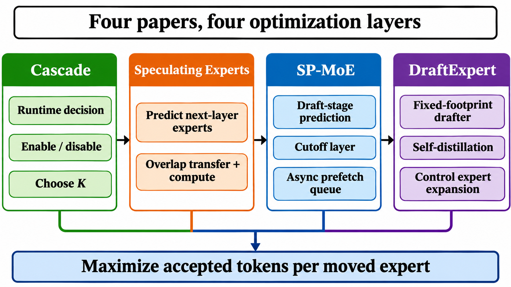

图 11 里四个框不是四个必须串联的模块，而是四个可以独立组合的优化层次：Cascade 管决策，Speculating Experts 管 decode 内部的 expert transfer，SP-MoE 管 draft-stage 的预取流水线，DraftExpert 管 drafter 的 footprint、接受率和验证扩张。

1. **控制层**：Cascade 决定什么时候值得做；
2. **运行时层**：Speculating Experts 和 SP-MoE 决定如何把 expert transfer 隐藏起来；
3. **模型/算法层**：DraftExpert 重新设计便宜且可预测的 drafter。

## 8. 一条统一的数据流应该长什么样？

如果把这些 ideas 组合进一个 MoE inference runtime，一次 iteration 可以抽象成下面的流程：

```python
def moe_speculative_step(request, state):
    # 1. 根据最近窗口估计 speculation utility
    utility = measure_utility(state)
    if utility < 1:
        # speculation 不值得，直接走普通 target decode
        return target_decode(request, state)

    # 2. 选择当前 speculation length
    k = choose_k_by_utility(state)

    # 3. 用固定 footprint 的 drafter 生成候选 token
    draft_tokens, draft_states = draft(request, k)

    # 4. 从 draft states 预测 target verification 会用到的 experts
    predicted_experts = predict_target_experts(draft_states)

    # 5. 控制 verifier expert union 的扩张
    draft_tokens = truncate_if_expansion_is_too_large(
        draft_tokens,
        predicted_experts,
    )

    # 6. 后台预取 target experts
    prefetch_async(predicted_experts, cutoff_layer=choose_cutoff(state))

    # 7. full target MoE exact verification
    accepted, state = verify_target(
        request,
        draft_tokens,
        state,
    )
    return accepted, state
```

这段伪代码不是某一篇论文的原始算法，而是把四篇论文的共同数据流压缩在一起，帮助理解各模块的职责：

- `measure_utility` 对应 Cascade 的运行时控制；
- `predict_target_experts` 和 `prefetch_async` 对应两类 expert prefetch；
- `truncate_if_expansion_is_too_large` 对应 DraftExpert 的 expansion-aware policy；
- `verify_target` 始终由 full target MoE 完成，保留 exact verification。

真正部署时，还需要处理 expert cache、异步 stream、CPU/GPU 或 Flash/NPU 的带宽竞争、请求调度和多用户 batch。这也是为什么论文中的 acceleration 数字不能简单相加。

## 9. 这些结果能吸收哪些设计原则？

### 9.1 MoE 优化不能只看 FLOPs

MoE 的“每 token 只激活少数 expert”很容易让人只关注计算量。但在显存装不下完整 expert pool 时，真正的瓶颈可能是：

```text
expert movement
    + cache miss
    + synchronization
    + verification expansion
```

因此做 MoE 推理优化时，不能只问“每个 token 算了多少 expert”，还要问“这些 expert 什么时候到 accelerator、搬了几次、是否真的被用到”。

### 9.2 预测不是目的，预测必须改变关键路径

expert hit rate 很高不代表一定加速。如果 prediction 结果没有及时转化为异步 transfer，或者预取任务堵塞了 compute，hit rate 只能停留在离线指标。

`Speculating Experts` 和 `SP-MoE` 的共同启发是：prediction 的价值要放到时间线上看。真正重要的是：

$$
\text{transfer time hidden by compute}
>
\text{prediction and scheduling overhead}.
$$

### 9.3 接受率不能脱离 draft cost

在 dense model 里，draft 越准通常越好；在 offloaded MoE 里，draft 变准可能意味着加载更多 expert，最后得不偿失。DraftExpert 把目标改成“accepted tokens per moved expert”，这比单独追求 acceptance 更接近系统真实目标。

### 9.4 动态策略不是锦上添花，而是 MoE 的必要条件

Cascade 说明静态 $K$ 不够，DraftExpert 说明固定 draft footprint 也需要和 verifier expansion 配合，SP-MoE 说明 cutoff layer 需要适配硬件和模型。MoE 的 expert 访问本来就是输入相关的，系统策略自然也不能完全静态。

## 10. 实验数字应该怎么读？

这四篇论文的数字不能直接排成一个排行榜：

- Cascade 的 7%–14% 是相对 static-$K$ 的 throughput 改善，同时强调把最坏 slowdown 控制在约 5%；
- `Speculating Experts` 的 5%–14% 是相对于 on-demand expert loading 的 TPOT 降低；
- SP-MoE 的 1.07×–3.5× 是在不同模型、环境和 baseline 下的 TPOT speedup；
- DraftExpert 的 1.45× 是端侧 expert-offload 场景下的平均 decode throughput 提升。

它们的 baseline、硬件、offload 路径、batch 设置和指标口径并不相同。更合理的读法是看每篇论文消除了哪一项瓶颈：

| 结果 | 说明 |
|---|---|
| Cascade 最坏 slowdown 约 5% | 运行时控制避免了 speculation 失控 |
| Speculating Experts TPOT 降低 5%–14% | decode 内部的 transfer 被 compute 覆盖 |
| SP-MoE 最高 3.5× | draft 阶段提供了额外 prefetch window，且 pipeline 设计有效 |
| DraftExpert 平均 1.45× | drafter 的 movement、acceptance 和 verify expansion 被一起约束 |

所以不能把四个数字相加，也不能说“用了四篇方法就一定得到 3.5× + 1.45×”。它们有互补关系，但也会竞争同一份 GPU memory、CPU–GPU bandwidth 和 runtime scheduling budget。

## 11. 总结：MoE speculative decoding 的主线已经从“猜得更准”变成“每次搬运是否值得”

普通 speculative decoding 的叙事是：

```text
draft 得更快
    → target 一次验证更多 token
    → throughput 提升
```

但放到 expert-offloaded MoE 里，完整叙事变成：

```text
draft 多个 token
    → verifier expert union 变大
    → expert movement 和 verify cost 上升
    → speculation 可能变慢
```

四篇论文沿着这条因果链分别补上了四个缺口：

1. `Cascade`：先测 utility，决定是否 speculate 以及 $K$；
2. `Speculating Experts`：预测下一层 expert，让 transfer 和 compute overlap；
3. `SP-MoE`：把预测前移到 draft 阶段，用 cutoff 和异步 worker 管好预取；
4. `DraftExpert`：让 drafter 保持固定 footprint，并控制 verify-side expert expansion。

真正值得吸收的不是某个孤立模块，而是一种系统视角：

> **MoE 推理优化的目标，不应该只是减少计算量或提高 acceptance，而应该最大化“每个新搬运 expert 带来的有效 token 收益”。**

这也解释了为什么后续工作会同时触碰 model architecture、router prediction、speculative decoding、expert cache 和 runtime scheduler。MoE 的稀疏性把计算省下来了，却把问题推到了“哪些权重什么时候移动”上。谁能把这条数据流管好，谁才真正拿到了稀疏激活带来的系统收益。

## 参考资料

- [Utility-Driven Speculative Decoding for Mixture-of-Experts](https://arxiv.org/abs/2506.20675)
- [SP-MoE: Speculative Decoding and Prefetching for Accelerating MoE-based Model Inference](https://arxiv.org/abs/2510.10302)
- [Speculating Experts Accelerates Inference for Mixture-of-Experts](https://arxiv.org/abs/2603.19289)
- [DraftExpert: Expansion-Aware Self-Speculative Decoding for End-Device MoE Inference](https://arxiv.org/abs/2607.24434)

---

顺带一提，这条线和模型压缩、模型融合、架构搜索其实是相邻问题：它们都在问，模型的哪些部分必须保留、哪些部分可以近似、哪些状态应该动态管理。《动手学 AutoML：从 NAS 到大语言模型优化实战》里整理了 LLM 压缩、模型融合和架构优化的相关方法；书里不覆盖这些 MoE expert offloading runtime，但如果想进一步把“哪些模块值得保留、哪些计算可以近似”变成可搜索的问题，可以接着看这个方向。

> 
